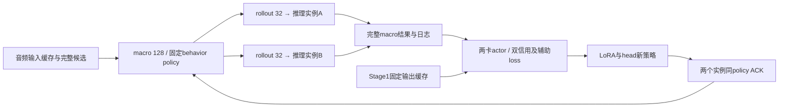

# Multimodal Jev：实验观测与下一步实验交接

**2026-11-18 最新启动调整：** 用户取消独立效率基线；当前v0.0.91后台控制器执行
prefix两更新→新进程恢复→真实尾批两更新→formal634，效率从正式训练固定窗口统计。
两卡训练、两个单卡推理实例，完整clean TRAIN和可编辑reward/loss默认公式保持。
固定镜像回归和实际封包重建已通过；后台控制器启动不等于正式训练已开始。
后续接手应核验准确句柄，禁止重复detach。入口及采样口径见
[组合式启动](../engineering/stage2-startup-root-causes-20261118.md#7-组合式启动与正式训练内效率统计)。
下方效率100步队列为历史记录。

**2026-11-18 启动根因复核更新：** v77 在首次更新前因 actor 模块搜索路径污染失败，
v79 后继已按前驱失败停止；下方“仍审核/已排队”仅为旧快照。Stage1 完整曲线 v76
已通过独立审核。本轮按[七类根因与自检清单](../engineering/stage2-startup-root-causes-20261118.md)
推进修复，新的宿主/固定镜像 CPU 证据不等于 Stage2 NPU 或正式训练准入。

**2026-11-18 07:41 UTC启动更新：** 用户已授权Stage2；使用可编辑reward/loss默认公式。
前置验收控制器v0.0.77仍执行CPU来源审核，正式NPU训练尚未启动；后继v0.0.79已作为
独立后台程序启动，验收成功后自动接续tail2→efficiency100→formal634，失败即停止。
同镜像27项CPU检查已通过，不能代替NPU验收。具体宏、启动命令、路径和证据见
[Stage2奖励扩展发布边界](../engineering/stage2-objective-release-contract-v1.md)。
以下早期状态按时间追溯，不代表当前live状态。


**2026-11-18 02:40 UTC审核链更新：** 当前控制器为v0.0.49，已接入Stage1并行来源审核与共同batch证明复用，原v0.0.45控制器已退出。全量来源证明及终点评测包重建通过；详见[审核链规约与实测](../engineering/scripted-parallel-audit-v1.md)。Stage2审核尚沿用原实现，评测成绩仍待实际完成。

**2026-11-18 01:56 UTC调度更新：** 用户要求CPU/NPU异步并行，已启动v0.0.45统一控制器并退出原六个串行控制器。Stage1全量评测已提前，CPU并行处理有限验收和效率准备；NPU就绪评测优先。模型、数据、门禁和四卡预算保持。旧文中的driver表与detach命令只供追溯，不能重新启动。当前入口及切换证据见[异步调度](../engineering/context-async-scheduling-v1.md)。控制器启动并不表示NPU评测完成。

交接日期：2026-11-18。状态采样时间：**2026-11-18 01:19–01:23 UTC（北京时间09:19–09:23）**。
适用对象：合作方算法、数据、训练、推理、评测、平台及集成负责人。

本轮任务是形成一条可信的证据链：四卡简单任务工程验收 → 实际训练效率 → SLURP任务收益 → 冻结策略跨数据集迁移。**Stage1 已完成，全量 reference 缓存已审核；Stage2连续两次更新已通过独立审核（见下方01:33 UTC更新）；本轮正式GRPO、完整效果曲线及迁移成绩尚未完成。**

**2026-11-18 01:33 UTC（北京时间09:33）更新：** 用户授权继续独立审核后现场核验，原序列已发布prefix成功终态 `finite_cached_reference_training_outputs_audited`，共2次更新、256条真实query，在线reference调用和reference策略切换均为0；两rank master重建到BF16导出精确一致，checkpoint未保存base模型。审核文件 `OPS/context-cached-prefix-v0.0.39/finalization/audit.json` 的SHA256为 `10b9aca936b3772144e02e2655aa3c92e30ac12b780ea87f57e26d48ab2c4380`，`terminal.json` 为 `3cfdf1f547fa91586777a8d3584fc76fd1bc2690924d0628cfbdf209769f7cad`。原驱动2320886的启动身份与argv匹配、现场为R，已写入 `prefix-result.json` 并进入tail封包准备；尚无tail/recovery审核终态。复用既有审核，没有重复启动。**这不是恢复、100步效率或正式训练准入。** 下文01:19–01:23 UTC表格保留交接时快照，以本更新覆盖prefix待审核状态。

以下是编写交接时的历史记录（后续已恢复推进并切换上述调度）：用户当时暂停本对话的自动目标推进，本次工作仅编写交接文档。**暂停目标不等于停止后台驱动或Docker容器**：本次只读核验发现既有后继驱动仍存活，它们满足前驱门槛后仍可能自行执行。本文没有停止、重启或重新派发任何实验。接手前先明确后台队列的负责方；不要直接再运行同一份 `detach` 命令。

长期规约见 [AGENTS.md](../../AGENTS.md)。本文件整理当前四卡方案，历史设计和证据见[原协作指南](simple-task-rl-engineering-guide-v1.md)与[工程索引](../engineering/README.md)。历史八卡、旧Stage1目标、旧初始化和旧协议不能混入本轮配置。本文状态均是带时间的快照，不是实时监控页面。

## 1. 范围、研究问题与成功判据

| 问题 | 本轮如何回答 | 不能作为替代证据 |
| --- | --- | --- |
| 工程是否可靠 | 相同音频/候选/策略的actor与vLLM对齐；连续更新、真实尾批、新进程恢复；完整账本重放 | CPU测试通过、包可生成、容器exit0 |
| RL训练是否更高效 | 固定四卡、同初始化和日程的最多100步对照；真实query吞吐及总成本 | 缩小数据、丢长音频、遗漏reference成本、两步探针时间 |
| 源任务是否改善 | 全量clean SLURP训练、完整selection曲线、冻结后的TEST | 训练reward上涨、只报最后一步或最高单批 |
| 能否迁移 | 同一冻结策略和阈值在FSC/MINDS上评测，与共同Stage1配对比较 | 在目标上选checkpoint、调prompt/阈值或挖难例 |
| 是否跨任务泛化 | 后续另定义具有独立可信监督的新判决任务 | SLURP→FSC/MINDS属于跨数据集意图迁移，不能直接称跨任务 |

当前仅做单音频、完整候选面板的原生互斥意图成员判决。简单任务仍使用全部SLURP难例。SFC、Audio2Tool、多音频历史、多意图组合、多步判决等复杂任务全部延期，不进入本轮交付依赖。

当前没有要求比较RL与同预算SFT。主要比较是本轮Stage1共同起点与GRPO策略；Stage2包含辅助监督项，不能把联合目标的改善全部归因于纯RL。负迁移和概率质量退化必须保留；完成实验不预设所有指标都必须上升。

## 2. 已观测结果与证据边界

下文 `OPS` 指当前控制主机的 `/srv/multimodal-jev-xingchao/operations`，只是现有证据位置的缩写，不是共享配置的硬编码。

| 阶段 | 本轮实证 | 接手结论 |
| --- | --- | --- |
| Stage1 InfoNCE，rc5 | 318更新、81,026真实曝光；独立审核并绑定11个checkpoint；`OPS/context-infonce-formal-dp4-v0.0.rc5/finalization/terminal.json` 为 `formal_infonce_audited_curve_bound` | 训练产物通过；11点selection还没有评分，不能引用旧634步结果替代 |
| Stage1终点训推面板，v0.0.37 | TRAIN256×60候选；logit/prob最大差0、threshold flips与top1 changes均0；`OPS/context-train-parity-v0.0.37/finalization/audit.json` | 有限面板exact，不是40,513条全部HF/vLLM对齐 |
| 全TRAIN reference，v0.0.39 | 40,513不同输入、317个macro；输出从日志及独立输入身份重建；`reference_collected_and_audited` | 缓存完整性与来源审核通过；不自动放行正式训练 |
| GRPO连续更新prefix，v0.0.39 | 容器已exit0/nonOOM并收集；运行器 `run/result.json` 声明 `start_update=0, stop_update=2, passed=true`；两次策略激活产物存在 | **独立审核尚未完成**；runner自报通过不是验收通过，不报训练收益 |
| 真实尾批、恢复 | 采样时尚无对应阶段运行产物 | 继续由既有有限验收序列按顺序执行 |
| 100步效率、Stage1曲线、634步GRPO、GRPO曲线、迁移 | 后继驱动已登记，现场进程存活，等待前驱 | 排队不等于NPU执行，不存在本轮完整分数 |

reference关键证据位于 `OPS/context-reference-job-v0.0.39/finalization/`：

| 文件/身份 | SHA256 |
| --- | --- |
| `terminal.json` | `979224ff9ee46d52c981c5a640f5a32d8e93f8b834339f1051baab1ecda3547b` |
| `audit.json` | `541b19840bcd58272af43100fa24627be06202a530c3f3d25ed3c66512e5b09f` |
| `reference-output-audit.json` | `d1bf2bdee4fdac6e6d186a9709ade44d6f2856f7fd2d28855e91e0fc63457826` |
| reference dataset manifest | `5d16cc09a81baf3c04a27c783258b30067ddf9ea164f4b89e64fb74f1f4925cb` |
| 本轮Stage1终点318 policy | `926e4d1316cefea8e39272b5153cbc7fb96880eb67b0da42896cd07ddc620095` |

审核保留 `full_population_parity=false`、`training_dispatch_allowed=false`，不是遗漏字段。缓存建库自身报告4042.28秒；容器约71分42秒。这两个数分别是builder内部时间和容器墙钟，均不是Stage2训练吞吐，也不包含控制端全部重审成本。

连续更新prefix容器：`e2e23d42fbd744411ed088d0217feceda71cc1327ab51f6d25c3bc7a91fe510b`。本次远端 `docker inspect` 确认00:48:38Z启动、00:54:57Z结束、exit0/nonOOM。证据根为 `OPS/context-cached-prefix-v0.0.39/`；独立审核关注 `finalization/audit.json` 和 `finalization/terminal.json`，不能仅看 `*-collection.json` 的传输完成状态。

### 2.1 只作历史参考的结果

| 历史结果 | 可以支持什么 | 不能支持什么 |
| --- | --- | --- |
| 旧100步效率：声学批处理+KV16合计吞吐提升12.5783% | 工程大项有优化潜力 | 当时存在目标域数值一致性失败；不是当前bounded runtime的加速成绩 |
| 旧Stage1 selection：set-F1 73.8041%、top1 82.0724% | 历史任务可学习性 | 旧634步来源，不能填本轮318步InfoNCE成绩 |
| 旧GRPO selection：set-F1 0.738041→0.809831；NLL 0.018743→0.056750，Brier退化至0.006903 | 决策改善与概率质量可能冲突，是双信用研究动机 | 非本轮双信用GRPO、非TEST、非迁移结果 |
| FSC SpeechBrain官方权重复测3774/3793=99.4991% | 相同官方TEST上的监督训练学术参考 | 不是Jev零样本迁移成绩或同训练预算比较 |
| SLURP Omni clean参考5207/12991=40.0816% | 相同clean TEST上的历史端到端原生意图参考 | 模型/训练条件不同，不是算法因果对照 |

详细出处见[工程索引](../engineering/README.md)、[FSC参考](../engineering/fsc-external-reference-comparison-v1.md)。HuBERT等缺资产的公开路线仍标未复现，不补填论文数字作为本地实验结果。

## 3. 模型与决策技术方案

输入是**音频及任务规约、完整候选定义**；由同一个Qwen3-ASR模型直接处理。禁止以参考转写代替音频，或ASR→独立文本LLM的串联路线。

主干为 `Qwen/Qwen3-ASR-0.6B-hf`，官方HF转换revision见[运行环境](../engineering/runtime.md)。对语言层q/v投影做LoRA，rank4、alpha8、dropout0。共享浅Transformer head使用hidden1024、8 heads、FFN1024、1层、residual scale0.1、dropout0；读取每个 `<|jev_decision|>` marker的表示并输出标量logit。marker ID151706；分支可见同一请求内有效的因果前缀，不跨音频样本注意。

每个候选输出 `p_i=sigmoid(z_i)`。候选间不做推理softmax，概率不要求和为1；候选定义可随数据集配置变化，不是固定类别专属线性分类器。Harness用冻结规则消费数值：主判决为阈值0.5的候选集合，另报argmax top1连接原生学术基线。

```json
{
  "request_id": "bound-input-id",
  "policy_id": "immutable-policy-id",
  "candidate_ids": ["candidate_a", "candidate_b"],
  "logits": [1.25, -0.75],
  "prob": [0.7773, 0.3208]
}
```

示意概率经过舍入，实际账本保存真实数值和输入身份。当前输出不包含转写、文本CoT、开放槽值或工具参数；槽值生成留给生成模型的研究边界另行定义。

### 3.1 数据与缓存分为两层

| 层 | 内容 | 更新与使用原则 |
| --- | --- | --- |
| 音频/processor输入缓存 | 音频派生张量、token/marker位置、mask、候选顺序及哈希收据 | 仍是音频输入；版本化只读，缺失或张量身份不符拒绝，评测不现场重建 |
| reference输出缓存 | 本轮Stage1终点对整个TRAIN的固定模型输出及策略/输入/runtime绑定 | Stage2只读；不是仅缓存前处理，也不是动态behavior缓存；不在线补算、不随actor更新 |

Stage2行为策略每步更新；reference始终是同一个Stage1终点。两者身份必须分别记录。缓存键绑定policy、base、processor、runtime、release、输入张量、marker位置、候选顺序；只按音频文件名查缓存是不充分的。

本轮不增加音量、语速、静音裁剪等增强。若后续研究增强，必须单独发布输入协议和缓存，先做数值与效果对照，不改当前冻结输入。

## 4. 数据工程与评测隔离

| 数据 | 人口 | 候选数 | 角色 |
| --- | ---: | ---: | --- |
| clean SLURP TRAIN | 40,513 | 60 | Stage1/Stage2训练、reference、源TRAIN诊断 |
| SLURP selection | 9,226 | 60 | 完整曲线、按预登记规则选模，不生成reward或采样反馈 |
| clean SLURP TEST | 12,991 | 60 | 模型冻结后的源域最终报告 |
| FSC官方TEST | 3,793 | native31 | 冻结策略跨数据集评测 |
| MINDS冻结上游TRAIN人口 | 8,168 | native14 | 外域/跨语言评测，不称官方TEST |

SLURP使用 `official-clean-intent-v1`，发布hash为 `38e4273d9328e4f02db081315e46f97a17628b974be7ba175254882e95421482`。已发现缺陷按逐标签准入；未获准监督不得用于训练、奖励或选模。缺失标签不补false，清理后指标单列，不把删样本视为算法收益。

当前标签表示“benchmark指定的互斥目标意图是否为该候选”，不等价于“话语中所有可能语义意图是否存在”。不要用单标签数据声称学到了完整多意图存在性。

TEST输入包曾绑定另一v2发布；现v0.0.43已为本轮v1重新制作并独立验证，输入人口与候选payload没有偷换。v0.0.44迁移队列绑定新包，不能因旧包文件名相似而替换。见[迁移客户端与封包](../engineering/context-replica-transfer-client-v1.md)。

MINDS按14语言变体及英语变体合并后的12语言分别报告。FSC可作说话者配对bootstrap；MINDS缺少已认证说话者分组时只作对应层级的描述统计，不假设样本独立给出夸大显著性。

## 5. 两阶段训练与强化学习目标

权威设计配置：[context-two-stage-v0.0.11.json](../../configs/experiments/context-two-stage-v0.0.11.json)。该文件中的pending/dispatch字段是设计时快照，实际准入取冻结运行包和真实审核；不要改设计状态来“解锁”训练。

| 项目 | Stage1 | Stage2 |
| --- | --- | --- |
| 目标 | InfoNCE区分性任务学习，唯一loss | 排序/成员判决双信用GRPO + 辅助项 + 固定reference KL |
| 总资源 | DP4训练 | DP2训练 + 两个各TP1的推理实例 |
| 当前175物理卡 | 4、5、6、7 | 训练4/5，推理6/7 |
| 每DP有效batch | 64 | 64 |
| global batch | `64×DP=256` | `64×DP=128` |
| microbatch / 累积 | 每卡8 / 8次 | 每卡8 / 8次 |
| epochs / updates | 2 / 318 | 2 / 634 |
| 每轮尾批 | 65真实 + 191 padding | 65真实 + 63 padding |
| 初始化 | 经认证的pre-Stage1 joint快照 | **本轮Stage1终点318**，重置optimizer |
| 学习率 | warmup16更新到1e-4，再恒定 | 1e-4，按冻结包 |
| 执行精度 | BF16 | BF16 |
| master / Adam / loss | FP32 | FP32；排序概率小张量协议使用CPU FP64 |
| reference | 无Stage2 reference消费 | 全TRAIN缓存，源策略固定318 |
| 随机种子 | 以正式包 `config.json` 为准 | 当前prefix实际包seed317；正式包仍须核对 |

全量真实曝光均为81,026。padding为零权重；Stage2尾批分母为65，不能除以128或drop_last。使用全局真实query分母，DP和microbatch累积不重复归一化。类分散与长度分桶只改变已声明日程布局，不删除难例、长音频或自然类别支持。

### 5.1 Stage1：InfoNCE

对目标候选和其他候选计算 `-log(exp(z_pos/T) / sum_j exp(z_j/T))`，当前T=1。仅以此学习区分性，不称“SFT+InfoNCE”，不附加文本生成或BCE。推理仍输出独立sigmoid，不改为softmax；相对排序学会不代表绝对概率已校准，因此NLL/Brier和阈值集合指标必须独立观测。

Stage1预登记11点：`0,32,64,96,128,160,192,224,256,288,318`。selection最优点单独报告；Stage2初始化与reference都取固定318，不替换成selection最优或100步效率终点。

### 5.2 Stage2：双信用GRPO

算法ID `dual_credit_grpo_floor_clipped_v1`；当前仅执行 `joint`，不再派发RLOO，PPO-critic仅设计预留。核心代码：[context_dual_credit.py](../../src/multimodal_jev/context_dual_credit.py)、[context_candidate_objective.py](../../src/multimodal_jev/context_candidate_objective.py)。

| 信号 | 动作分布 | reward | 作用 |
| --- | --- | --- | --- |
| 排序 | 异标签候选对的 `sigmoid(z_left-z_right)`，左右由候选ID顺序确定 | 采样方向与左侧是否正类一致为1，否则0 | 改善候选相对优先级；不按gold重排输入 |
| 成员/存在性 | 每候选Bernoulli(sigmoid(logit)) | 采样二元判决与原生成员标签一致为1，否则0 | 改善绝对判决概率和阈值行为 |

每个分量G=16，在已获得的候选logit上采样；不是每条音频做16次模型前向。存在性正负两组都存在时各占总权重0.5，排序候选对内部归一化。每分量优势：

```text
A = (reward - group_mean) / max(population_std, 0.25)
L_RL = 0.5 * L_rank_GRPO + 0.5 * L_member_GRPO
L = L_RL + 0.1 * L_pairwise_softplus
         + 0.3 * L_candidate_binary_NLL
         + 0.01 * KL(Bernoulli_current || Bernoulli_reference)
```

策略优化复用固定verl `compute_policy_loss_vanilla`，clip=0.2、dual-clip参数3。候选分量→query→全局真实query归一化；NLL在已观察候选内平均，KL按候选求和后按query归一化，两者不能混用分母。辅助系数本轮固定，没有启用随训练衰减。

框架层复用verl actor/FSDP及策略损失，但不是原生 `verl.trainer.main_ppo` 直接传入音频即可工作；音频数据、typed概率输出、两实例macro客户端、reference缓存和保存恢复都有项目适配。复用PPO actor类不代表启用了critic-PPO。

全组reward相同会产生零优势，必须报告有效信用比例。另一个常见误判：on-policy更新前ratio约1，中心化优势使RL标量loss接近0，**不代表RL梯度为0**；应结合动作分布、优势、分量梯度和更新后指标判断，不能只看 `jev/dual_rl` 的标量大小。

### 5.3 LoRA切换与保存

两个stage分别声明完整LoRA配置，当前相同且 `stage2.reuse_stage1_adapter=true`，继续同一adapter权重并重置optimizer。false即使配置相同也新建Stage2参数、保留冻结Stage1；异配置复用必须报错。双adapter组合未通过对应NPU/vLLM验收的，不得静默当作已支持。

checkpoint仅保存LoRA、共享head、必要marker与optimizer状态；主模型只以路径/hash引用。每步可发布LoRA/head给推理服务，这与恢复checkpoint不同：正式634步只在预登记非零点保存optimizer；100步效率包当前每步保存，故两者成本不可直接等同。

## 6. 训练与推理协同协议



每个rollout完整交给一个推理实例，一次macro通常4个rollout；两个实例可并发，分步完成rollout，但**全部128条同一behavior policy的结果完整后**才由训练端消费。每macro一次actor更新，两个服务确认新策略后才开始下一macro，禁止混用陈旧策略。

service batch32是外层请求容量，不代表所有内部算子都必须无界batch32。当前源采用有界attention分组（8）与声学chunk批处理（32）来满足数值协议；不能直接把内部边界改大以换吞吐，必须另立候选做对齐和100步对照。

账本必须有request/rollout/macro ID、完整候选顺序、输入tensor哈希、policy/runtime身份、真实logit/prob、old logprob、动作、reward、advantage及两实例激活ACK。部分macro失败不得更新；策略刷新失败保留原事务，不重复消费。

## 7. 镜像在哪里，谁驱动谁

### 7.1 已验证运行环境

本次在175（当前SSH别名 `npu`）只读 `docker image inspect` 确认镜像存在、架构arm64、tag如下：

```text
multimodal-jev:verl-v030-20261109
sha256:52ba94e1b6ba35f09066a92222f013ce9563fdbd83a6a5e7a60d209ac29f756c
```

**这是本地Docker image ID，不是已发布镜像仓库的manifest digest或拉取地址。** 合作方新机器须由平台团队提供该镜像归档及校验，或按Dockerfile构建独立候选并重新验收；重建不能保证得到同一ID，不能只改tag冒充当前镜像。

| 组件 | 当前锁定值 |
| --- | --- |
| 基础镜像 | NGA `nga-verl-qwen35-v030:20261029`，base ID `sha256:8190b3ec51929baca2388452039ccf05d681c01b7c91cc55dd1e7ac5570a76b7` |
| 架构 | Linux ARM64 / Huawei Ascend |
| Python | 3.12.13（镜像库存） |
| torch / torch-npu | 2.10.0+cpu / 2.10.0.post7（安装包版本字符串，实际NPU经torch-npu） |
| Transformers / PEFT | 5.14.1 / 0.21.2 |
| vLLM / vLLM-Ascend | 0.30.0+empty / 0.30.0rc2 |
| verl | 0.8.0.dev0，commit `e9405d70b77d56a23e72bb2e40a17b906856e913` |
| Ray | 2.48.0 |

版本证据：[IMAGE-MANIFEST.json](../../docker/multimodal-jev/IMAGE-MANIFEST.json)、[runtime.md](../engineering/runtime.md)、[runtime-receipt.json](../engineering/runtime-receipt.json)。版本相同只是必要条件，还要匹配源码、算法文件hash、输入和数值路径。

[Dockerfile](../../docker/multimodal-jev/Dockerfile)从固定NGA底座增量构建、不联网解析依赖，镜像不含模型/数据。其历史 `HF_HOME` 和manifest的输出路径含Ceph默认值，**当前launcher会覆盖为本地盘路径**；不能直接套Dockerfile示例裸跑热写Ceph。

### 7.2 控制面与计算面

1. 控制主机仓库运行 `tools.reports.*` 的确定性Python驱动，读取portable模板和本地宏。
2. 驱动审核父包、源码pins、数据/策略身份与资源租约，生成封存运行包并传到目标主机的本地 `/data`。
3. 经SSH在175执行 `docker create/start/wait/inspect`；使用固定镜像、只读输入挂载及限定NPU设备。
4. 容器入口 `/opt/multimodal-jev/runtime-entrypoint.sh` 启动包中的 `run.py`，后者监督actor和推理服务；源码以封存包 `source/` 为准，不是将正在修改的工作树直接挂入计算。
5. 控制端收集产物与传输清单，独立重建审核；后继用准确PID/start ticks/argv和pidfd等待前驱，再重审证据。

当前共享launcher生成 `--pull=never --network=none`，只映射所需davinci设备及管理设备，Ascend驱动库只读，24 CPU/128GiB容器内存/8GiB共享内存，日志轮转20MiB×2。具体启动命令以本次 `*-launch.json` 的 `argv` 为准，不按文档重新手拼命令。

每个推理实例只看见自己的一张卡；容器内逻辑卡号与主机物理4/5/6/7不能混用。175四卡之外和181不是本轮额外资源。

### 7.3 配置与文件位置

| 位置 | 用途 |
| --- | --- |
| `configs/portable/operations/*.json` | 共享模板，读取 `${MACRO_NAME}` |
| `.local/config/macros.json` 或每任务本地JSON | 机器路径、地址、卡、lease、产物身份绑定；不入库 |
| `OPS/*-prepared/` | 生成的冻结包，含PREPARED、config、source manifest等 |
| `OPS/<run>/` | 控制侧句柄、收集、审核和终态 |
| 目标主机 `/data/xingchao/...` | 实际容器热工作目录（本地宏绑定） |
| `/mnt/cephfs/xingchao/models`、`datasets` | 共享模型/数据，只读 |

当前控制仓库 `/home/xingchao/workspace/multimodal-jev`。模型为 `models/Qwen__Qwen3-ASR-0.6B-hf`，base身份 `02fe809e756cd2de3d9fa5364c763bb5127d50d8956f2570c265e7c34264a458`；processor身份 `41f8edc45719bb2d02b385f57520b862f605df05d38fea60788eed8115ee96fe`。这些位置用于找现有资产，迁移后必须集中改本地宏并重新审核，不能在共享模板到处替换绝对路径。

## 8. 如何启动：先接管，再谈新运行

### 8.1 当前队列：不要重复启动

本次现场 `/proc` 核验下列PID及模块身份。S只说明进程睡眠，不能推出卡被占用；R也不能推出已开始NPU训练，可能是在CPU重审。

| 阶段 | 版本 / 本地绑定文件（`.local/config/`内） | PID / start ticks | 快照 |
| --- | --- | --- | --- |
| 有限验收 | `context-cached-acceptance-v0.0.39.json` | 2320886 / 352863380 | R；prefix已收集、独立审核待完成 |
| 100步效率 | `context-cached-efficiency-successor-v0.0.39.json` | 2321008 / 352866790 | S；等待有限验收 |
| Stage1完整selection | `context-replica-selection-sequence-v0.0.40.json` | 2321924 / 352910798 | S |
| 正式634步GRPO | `context-cached-formal-successor-v0.0.41.json` | 2322614 / 352945243 | S；目标rc6名称不等于已发布 |
| GRPO完整selection | `context-cached-grpo-evaluation-sequence-v0.0.42.json` | 2324817 / 353009059 | S |
| FSC/MINDS/TEST | `context-replica-transfer-sequence-v0.0.44.json` | 2330248 / 353217925 | S |

接管步骤：读取对应 `started.json` 与解析后的 `config.json`，核对PID启动时间和argv，再查准确容器ID；确认目前唯一owner和lease。已有运行/排队依赖不能原位改动，已有目录不能当作新运行输出。对话目标暂停不会撤销已启动子进程里的派发开关。

### 8.2 新环境或新候选的通用准备

1. 平台提供固定镜像、驱动/CANN兼容性、四卡设备及统一lease；验证本地盘和共享只读路径。
2. 接收源码版本及封存source/pins、数据release及审核依赖、模型/processor、输入缓存、Stage1快照和reference。单独Git checkout不足以复现本轮：工作树存在未提交内容，镜像也不能代替后续封存源码。
3. 在本地宏中填写完整对象。portable文件通常只有宏引用，空的 `macros.json` 不会自动生成所有stage参数；参考上述当前绑定或对应入口文档提供的字段，迁移前驱路径/hash也须重新绑定。
4. 所有新 `output/package/operations_root/remote_root/tag` 用独立版本，不能覆盖既有/排队路径；保持输入、输出和缓存根互不重叠。
5. `--help`确认CLI，解析宏，执行validate；validate可能重审大体积证据，耗时不表示启动了NPU。随后才在新输出上执行一次detach。

控制主机现有驱动使用 `/usr/bin/python`，因为项目 `.venv` 缺torch。CPU验证依赖还包括本地 `.local/verification-python`；合作方应建立满足导入的控制环境，不将该依赖目录的存在当作通用前提。NPU计算始终使用固定镜像，不在控制主机临时pip升级来改变实验。

下面是**新运行模板**，本次未执行。先由团队在自己的shell设置这些变量为已验路径：

```bash
# 在仓库根目录；路径集中绑定，示例不提供任何凭据。
export PYTHONPATH="$JEV_REPO/src:$JEV_REPO/tools/jev:$JEV_REPO"
export OMP_NUM_THREADS=1

"$JEV_CONTROL_PYTHON" -m tools.configure \
  --config configs/portable/operations/context-cached-acceptance-sequence.json \
  --local "$JEV_TEAM_MACROS" \
  --output "$JEV_LOCAL_OPERATIONS/resolved/finite-v0.0.N.json"

"$JEV_CONTROL_PYTHON" -B -m tools.reports.context_cached_acceptance_sequence \
  --config configs/portable/operations/context-cached-acceptance-sequence.json \
  --local "$JEV_TEAM_MACROS" --action validate

# 仅在前驱、资源和新输出已核实、没有现有owner时执行一次：
"$JEV_CONTROL_PYTHON" -B -m tools.reports.context_cached_acceptance_sequence \
  --config configs/portable/operations/context-cached-acceptance-sequence.json \
  --local "$JEV_TEAM_MACROS" --action detach
```

`JEV_REPO`为仓库根，`JEV_CONTROL_PYTHON`为控制环境解释器，`JEV_TEAM_MACROS`为本地绑定文件，`JEV_LOCAL_OPERATIONS`为本地持久盘输出。`v0.0.N`是示意，实际必须换唯一候选版本。shell变量不替代模板宏；解析器仍从JSON加载宏。

### 8.3 各阶段实际入口

以下模块前缀均为 `tools.reports.`，模板位于 `configs/portable/operations/`。除特别注明，序列支持 `--action validate/run/detach`；正式长任务用detach，run是其后台内部流程。**不要将整张表盲目顺序重跑**：当前已有后继链，新队列须绑定前驱实际生成的driver/config身份。

| 工作 | 模块 | 模板名 | 宏 |
| --- | --- | --- | --- |
| Stage1正式包及训练 | `context_infonce_formal` | `context-infonce-formal.json` | `INFONCE_FORMAL_CONFIG` |
| Stage1独立收尾 | `finalize_context_infonce` | `context-infonce-finalization.json` | `INFONCE_FINALIZATION_CONFIG` |
| TRAIN面板一致性 | `context_train_parity_operations` | `context-train-parity-operations.json` | `TRAIN_PARITY_OPERATIONS_CONFIG` |
| 全TRAIN reference | `context_reference_job_operations` | `context-reference-job-operations.json` | `REFERENCE_JOB_OPERATIONS_CONFIG` |
| prefix→tail→recovery | `context_cached_acceptance_sequence` | `context-cached-acceptance-sequence.json` | `CACHED_ACCEPTANCE_SEQUENCE_CONFIG` |
| 100步效率 | `context_cached_efficiency_successor` | `context-cached-efficiency-successor.json` | `CACHED_EFFICIENCY_SUCCESSOR_CONFIG` |
| Stage1完整selection | `context_replica_selection_sequence` | `context-replica-selection-sequence.json` | `REPLICA_SELECTION_SEQUENCE_CONFIG` |
| 正式634步GRPO | `context_cached_formal_successor` | `context-cached-formal-successor.json` | `CACHED_FORMAL_SUCCESSOR_CONFIG` |
| GRPO完整selection | `context_cached_grpo_evaluation_sequence` | `context-cached-grpo-evaluation-sequence.json` | `CACHED_GRPO_EVALUATION_SEQUENCE_CONFIG` |
| 三数据集三角色评测 | `context_replica_transfer_sequence` | `context-replica-transfer-sequence.json` | `REPLICA_TRANSFER_SEQUENCE_CONFIG` |

Stage1入口支持prepare/validate/launch/detach/audit；prepare输入与执行部署输入不同，按[Stage1正式模块](../../tools/reports/context_infonce_formal.py)装配，不能拿一份不完整宏通用所有action。Stage1 detach只负责训练生命周期，**还需单独登记 `finalize_context_infonce --action detach`**，完成独立训练审核并发布11点计划。该finalizer只支持run/detach。

reference入口的 `run` 包含wait/collect和独立审核；`launch`不等于已独立审核。新reference必须绑定同一Stage1终点的TRAIN面板审核。各序列的前驱hash来自真正的driver记录与已解析配置，不手写一个假成功终态。

如果要在新环境从零复现，除上表外必须先完成Stage1有限连续更新、真实尾批、恢复门槛和输入日程准备，不能直接跳正式训练。具体产物与验收路径见[四卡基线](../engineering/context-four-device-simple-baseline-v1.md)。

正式GRPO的新后继使用同样的validate→detach模式；本地宏需含真实Stage1曲线前驱、效率证据以及全新输出。下面仅为已具备前置产物的新运行示例，不能对本节8.1已有队列再次执行：

```bash
"$JEV_CONTROL_PYTHON" -B -m tools.reports.context_cached_formal_successor \
  --config configs/portable/operations/context-cached-formal-successor.json \
  --local "$JEV_TEAM_MACROS" --action validate

"$JEV_CONTROL_PYTHON" -B -m tools.reports.context_cached_formal_successor \
  --config configs/portable/operations/context-cached-formal-successor.json \
  --local "$JEV_TEAM_MACROS" --action detach
```

模板的 `CACHED_FORMAL_SUCCESSOR_CONFIG` 对象至少声明 `predecessor`（driver/config/terminal与hash）、`experiment`（package/remote_root/operations_root/tag）、`output`、`formal_training_dispatch_allowed=true`；完整约束由对应validate核对。不能仅复制上述字段名而缺少真实前驱证据。所有等待节点只登记一次，之后通过自身准确前驱句柄推进。

## 9. 观测什么、在哪里看、怎样解释

### 9.1 状态、进度和审核

普通远端观测固定900秒。固定工具 `tools.reports.observe_context_replica_training` 读取 `*-launch.json` 里的准确容器，并在观察目录记录attempt/result；未到间隔返回 `not_due_no_remote_call`。持续监听用 `watch_context_replica_training`，已有监听则复用，不能新建多个轮询器。

```bash
"$JEV_CONTROL_PYTHON" -B -m tools.reports.observe_context_replica_training \
  --config configs/portable/operations/context-replica-training-watcher.json \
  --local "$JEV_OBSERVER_MACROS"
```

observer本地宏需对应实际运行包manifest、tag、operations_root和host；不能把另一个运行的launch句柄接进来。状态工具不负责全套性能profiling，未采到的利用率/显存记为不可得；若要新增采集，使用统一脚本和版本化配置。终态事件可以立即处理，不能因观测超时就重启。

| 看哪里 | 看哪些字段 | 判定 |
| --- | --- | --- |
| `driver/started.json`或同级`*-driver/started.json` | PID、start ticks、argv | 结合/proc判断owner真实身份 |
| `*-launch.json`、Docker inspect | container_id、image、argv、State、OOMKilled、ExitCode | 计算容器真实状态；exit0只是进入收集审核的条件 |
| `run/rank-*/progress.json`、`update-*.json` | 各rank更新进度、时间、有限数值、错误 | 各rank一致推进；丢rank不能只看rank0 |
| `run/activation-*.json`、策略提交记录 | 两服务ACK、policy ID、错误 | 新macro前两个实例必须同一新策略 |
| `*-collection.json`、`*-collected.transport.json` | 文件清单、传输hash、容器归属 | 传输完成不等于训练/评测审核通过 |
| `finalization/audit-config.json`、`audit.json`、`terminal.json` | 实际审核输入、status、范围、成功或异常 | 以完整独立审核作为放行依据 |
| 序列根`terminal.json`、`completed-*.json` | 所有必需点/阶段是否齐全 | prefix不能冒充完整曲线；waiting.json可能是历史不可变记录 |

### 9.2 算法与效果指标

| 维度 | 必报项 | 解释与行动 |
| --- | --- | --- |
| 原生任务 | top1 accuracy、top1 macro-F1、类别support | 与原生学术基线对齐；保持同分母 |
| Harness集合决策 | query macro set-F1@0.5、exact set、precision/recall、空集/多选率、返回候选数 | 主指标；空集/多选退化可能被top1掩盖 |
| 概率 | binary NLL、Brier；正负/类别分层 | 均越小越好；候选多时总体均值易被负例主导 |
| RL信号 | 排序和成员分量reward/advantage、组std、零优势比例、动作概率/熵、clip/ratio、更新后KL | 区分有信用和饱和，不用reward均值替代泛化 |
| 优化 | `jev/dual_rl`、`jev/dual_auxiliary`、`jev/dual_kl_unweighted`、grad norm及有限值 | 当前日志部分为microstep数组，必须按实际归一化还原，不能直接跨batch求和 |
| 概率对齐 | 同策略logit/prob最大差、阈值翻转、top1变化、样本宽度/长度覆盖 | exact面板要求logit与prob同时满足，不能只看top1不变 |
| 迁移 | Stage1→选中GRPO/终点的同人口差值、改善/退化条数、类别/语言分层 | 目标集不参与选模；同时公布负迁移 |

NLL是 `mean[-y*log(p)-(1-y)*log(1-p)]`，错误且过度自信会受到较大惩罚；Brier是 `mean[(p-y)^2]`，衡量概率与0/1标签的平方误差。二者不等于accuracy，也不能仅因降低就宣称“完全校准”。不同候选宽度分别报告，不将60/31/14候选直接混池。

每个selection点执行同策略HF256面板，再跑两个vLLM实例的完整9,226条；HF结束后才启动服务，不超四卡预算。目标域分别绑定FSC64、MINDS259、SLURP TEST269条面板，仍是有限数值验收。正式报告明确“有限面板exact”，不扩大为任意输入保证。

当前训练行为检查与评测exact是不同层次：历史协议给出prob 2e-7、binary logprob 2e-6的行为门槛；具体准入以本次冻结包为准，不凭文档改阈值。未来发生差异先保存原tensor、输入邻居/slot、长度、marker与策略身份，逐层定位，不靠夹紧概率、放宽容差或删除样本解决。

### 9.3 效率指标与成本口径

固定统计入口为 `context_cached_efficiency_cost`（成本）、`context_macro_efficiency_summary`（更新循环），协议见[四卡缓存效率](../../experiments/context-cached-grpo-efficiency-v1.md)。100步完整报告之外，预登记去掉前5步后单列95步窗口，不能事后挑最快区间。

必须区分：

- 全部真实query数 / 完整step墙钟得到的query吞吐；DP耗时取各rank最大值，padding不算query。
- preparation、前台等待、rollout、reference读取、信用计算、actor更新、导出、checkpoint和同步；重叠和嵌套时间不相加。
- 冷启动/加载/服务准备、建库、CPU审核、封包传输、收集和评测的端到端成本；未细分测量则标不可得。
- 分配卡时与实际活跃卡时；四卡分配时长不是NPU计算利用率。
- 每秒有非零信用的真实query数量，辅助解释高吞吐却学习效率低的问题；当前collector没有的字段要列“待固定脚本支持”，不可临时猜测。

本轮100步曝光12,800条，reference全量40,513条；一次建库成本应完整列出，不假设未来重复次数来摊薄。本轮效率每步optimizer保存，正式稀疏保存，所以100步数不能直接线性外推634步实际耗时。缺匹配对照时只报告绝对吞吐，不报加速百分比。

### 9.4 下一阶段成功终态

| 节点 | 独立审核后才接受的终态 |
| --- | --- |
| reference | `reference_collected_and_audited` |
| prefix | `finite_cached_reference_training_outputs_audited` |
| tail | `finite_cached_reference_tail_outputs_audited` |
| recovery | `finite_cached_reference_recovery_audited` |
| 有限验收序列 | `cached_finite_sequence_audited` |
| 效率序列 | `cached_efficiency_collected_audited_and_measured` |
| Stage1 selection | `replica_infonce_curve_collected_and_audited` |
| 正式GRPO训练 | `formal_cached_training_collected_and_audited` |
| GRPO selection | `cached_grpo_source_curve_collected_and_audited` |
| 全量迁移/TEST评分 | `replica_three_dataset_role_matrices_scored` |

状态字符串也不是唯一证明：接收方仍须确认其audit输入、容器、hash和完整人口来自约定运行，不能手工补写终态文件。

## 10. 下一步实验计划与停止条件

| 优先级 | 工作 | 完成产物 | 进入下一步的条件 |
| --- | --- | --- | --- |
| P0 接管 | 确认目标暂停与后台队列ownership；核对镜像/配置/准确句柄 | 单一负责人和现场状态记录 | 不重复启动，不混用旧任务 |
| P1 有限验收 | 完成prefix独立审核，再真实尾批、恢复 | 3份真实NPU审核、策略/master/Adam/采样/恢复证据 | 任一失败保留现场并停止下游，不自动重试 |
| P2 效率 | 100步缓存GRPO、完整成本与稳态窗口 | 审核通过的效率报告，必要的匹配对照 | 数值一致、零reference miss、完整100步；未有匹配基线不宣称加速 |
| P3 Stage1评测 | 11点×9,226 selection | 完整曲线、最优点、318终点分开记录 | 每点数值与输入/评分重审通过 |
| P4 正式GRPO | 从318重新开始，两轮634更新 | 81,026真实曝光；全更新策略、稀疏恢复点及训练审核 | 不续训100步效率终点；不读取目标反馈 |
| P5 GRPO评测 | 11点×9,226 selection | 全曲线、退化、三种冻结角色 | set-F1最高→NLL最低→最早步，允许选择step0 |
| P6 最终评测 | 三角色分别完成FSC/MINDS/clean TEST | 全人口预测、配对变化、概率与语言/类别分层、成本 | 先冻结角色；每策略独立parity，所有输入完成后评分 |
| P7 结论与消融 | 完整源收益/迁移结论后再预登记下一轮 | 学术参考表、复现清单、失败与边界 | 不根据已曝光目标成绩反复调参后仍称零样本独立测试 |

Stage2预登记11点：`0,64,128,192,256,320,384,448,512,576,634`。最终角色为 `common_Stage1`、`source_selected_new_GRPO`、`fixed_endpoint_new_GRPO`；角色可对应同一policy ID，只执行一次认证推理但保留三角色含义。

v0.0.44按固定顺序FSC、MINDS、SLURP TEST执行，所有目标输入推理完成后才进入gold评分。TEST与迁移目标均不参与训练、阈值选择、reference生成或难例挖掘。

当前不预估“距完成还有几个小时”：全量selection、源评测、迁移与重复审核成本尚无本轮完整测量。合作方按已完成阶段的实测时间与剩余工作量给范围估算，注明容器时间、控制端重审及资源排队。

### 10.1 下一轮研究候选（当前不派发）

完成本轮后优先研究大项：

1. **双信用消融**：ranking-only / member-only / joint，在相同Stage1、runtime、全量TRAIN、辅助项和预算上比较；明确单臂权重规则，不静默重缩放。至少报告源选择曲线与概率退化，跨域评测使用预登记的独立验证方案。
2. **源TRAIN难度更新**：轨迹采样→可处理/不可处理配比，保留全类别覆盖和均匀锚点，保存采样概率与seed；用自然分布流或校正处理概率学习偏差，不读FSC/MINDS评测轨迹。
3. **大块效率**：分别测actor、rollout、封包/审核、I/O/checkpoint成本，再决定瓶颈优化。重审可能占据控制面大量CPU时间，CPU忙碌不等于NPU利用高；先profiling，再在新候选中消除重复工作，不能绕过完整性检查或改当前冻结依赖。
4. **辅助损失与KL**：仅在源TRAIN诊断支持时预登记系数/衰减对照。用概率质量、排序与决策曲线共同判断，不用一次reward提升就改正式运行。

复杂任务仍不进入本轮。未来跨任务泛化需另有可信新判决标签、数据划分和迁移协议；不能用当前两目标集改名完成该研究目标。

## 11. 存储、故障与交付责任

Ceph共享模型/数据只读；热日志、checkpoint、缓存、临时目录、锁、编译产物、Ascend日志与vLLM IPC落本地持久盘。当前有Ceph fsync相关主机故障史，**不全局禁用Python fsync**：本地关键提交仍需flush/fsync/原子rename/目录同步，Ceph禁止热写与同步。见[存储规约](../engineering/runtime-storage-policy.md)。

检查本地剩余容量至少20GiB、inode至少5%，并满足实际产物预算；不依赖百分比空闲空间替代容量规划。共享引用路径、legacy SLURP审核文件的只读挂载必须完整；v0.0.37曾因漏挂载在推理前失败，v0.0.39已修复并完成建库，见[发布依赖](../engineering/context-release-deployment-v1.md)。

失败处理：保存准确容器/进程、原始日志、输入/策略身份和结构化error；由固定collector独立审核。驱动消失但无终态需先对账，不自动创建新attempt；原运行包不可改。修复用新 `v0.0.N`，验收后才锁 `v0.0.rcN`。不因文档预先写了rc6名字就当作已验收发布。

清理按固定脚本与清单：保护运行/排队/待审核依赖；最终结果、配置、选中及终点策略、必要恢复点和失败证据先归档校验。未完成11点评测前不能只保留最后checkpoint；不得全局docker prune或清理其他项目资产。

| 责任方 | 本次交接后最先处理 | 最小交付 |
| --- | --- | --- |
| 集成负责人 | 确认现有后台队列ownership和是否继续；维护单一资源租约 | run ID、driver/container、配置/pins、阶段终态和未完成项 |
| 平台 | 镜像归档/加载、Ascend环境、本地容量、Ceph只读 | image ID、版本库存、设备映射、挂载与存储核验 |
| 数据 | v1发布、审核依赖、全人口缓存、TEST v0.0.43绑定 | release/input/candidate哈希、split统计、泄漏与覆盖证明 |
| 训练/推理 | prefix/tail/recovery与macro一致性 | 两rank训练、双实例ACK、对齐tensor、恢复证据 |
| 算法 | 解释排序/成员信用、辅助项、概率退化 | 固定loss/reward/归一化口径、TRAIN诊断、下轮消融注册 |
| 评测 | 全曲线、冻结角色、全量目标评分 | 可重放预测、指标与退化、语言/类支持、不确定性和成本 |

每次交付至少包含：代码及封包身份、镜像、数据/模型/processor/reference身份、完整命令与解析provenance、资源分配、实际完成量、收集清单、独立审核、结果路径、限制。日常统计、采样、清理与串接由脚本＋配置执行，不通过模型逐step人工驱动。

## 12. 交接文件导航

- [当前工程索引](../engineering/README.md)、[四卡基线](../engineering/context-four-device-simple-baseline-v1.md)。
- [宏与配置规约](../engineering/local-config-macros-v1.md)、[LoRA切换](../engineering/stage-lora-policy-v1.md)、[LoRA存储](../engineering/lora-checkpoint-storage-policy.md)。
- [reference真实审核证据](../engineering/context-release-deployment-v1.md)、[缓存GRPO效率协议](../../experiments/context-cached-grpo-efficiency-v1.md)。
- [Stage1完整selection](../engineering/context-replica-selection-v1.md)、[正式GRPO后继](../engineering/context-cached-formal-successor-v1.md)。
- [GRPO完整selection](../engineering/context-cached-grpo-evaluation-v1.md)、[三数据集迁移客户端与队列](../engineering/context-replica-transfer-client-v1.md)。
- [训推精度对齐方法](../engineering/verl-vllm-lora-span-alignment-v1.md)、[SLURP质量限制](../engineering/slurp-quality-hold-v1.md)。

接手时首先核对第2、8节的现场与审核状态，再按第10节推进。本文中的启动命令是交接说明，本次文档工作没有执行这些启动动作。
