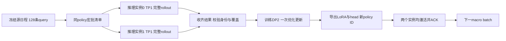

# Multimodal Jev 简单任务强化学习实验与工程协作指南 v1

最新操作交接见[2026-11-18实验观测与下一步计划](simple-task-experiment-observation-handoff-20261118.md)。该文核对本轮四卡配置、实际CLI及reference审核/prefix待审核状态；本页下文保留的旧初始化、旧数据身份与旧启动示例不应直接套入新运行。

**当前生效约束：正式实验总预算四卡（Stage1 DP4，Stage2 DP2 + 两个TP1推理实例），仅简单任务。** 最新配置与预算见[四卡基线](../engineering/context-four-device-simple-baseline-v1.md)及 `configs/experiments/context-two-stage-v0.0.11.json`；下方八卡/6+2说明为历史方案。
Stage1 以唯一 InfoNCE loss 学习区分性任务并使用 warmup；Stage2 使用排序/存在性双信用 GRPO，初始化及固定 reference 均取本轮 Stage1 的318步终点。reference 预缓存完整 TRAIN，训练只读、缺失拒绝。本文旧 pairwise Stage1、DP2 效率值等保留其原证据边界，不代表当前方案已经验收。

分阶段 LoRA 使用显式 `stage2.reuse_stage1_adapter` 开关；配置相同也可选择新参数。当前配置为上述 v0.0.11，规则及验收边界见 [分阶段 LoRA 规约](../engineering/stage-lora-policy-v1.md)。
> 状态快照：2026-11-17 UTC。本文供算法、数据、训练、推理、评测和平台团队共同执行。
> 当前阶段：简单任务的训练效率、SLURP任务收益及FSC/MINDS跨数据集迁移。
> 本文是协作入口；实际运行身份以冻结包、配置、源码清单、容器回执和独立审核结果为准。
> 新团队应复用统一工程与本地宏，不能直接复用其他主机的设备号或凭据。

**交接结论：Stage1 已完成318次更新并独立审核，完整selection曲线尚未评分；Stage2 尚未准入。** 历史声学批处理＋KV16在完整100步对照中吞吐提升12.5783%，同时暴露batch32概率一致性失败。分组attention候选 v0.0.32 已在该已知完整模型案例上独立验证精确一致，本轮318终点TRAIN256已独立审核exact；完整reference因部署缺少历史审核文件只读挂载而失败，修复及后继继承校验见[发布依赖校验](../engineering/context-release-deployment-v1.md)。完整reference和GRPO有限验收仍待完成。不能将历史吞吐或修复案例称为当前训练加速、任务收益或迁移收益。

团队接入顺序：

1. 算法、数据和评测负责人共同确认第3–5节的输入输出、监督边界和目标函数。
2. 平台、训练和推理负责人按第6–8节核对环境、宏批协议与准入条件；第9节提供交接时已有证据。
3. 按第11节认领交付接口，按第12–13节建立本地宏、固定脚本和产物目录。
4. 集成负责人按第14节P0–P6顺序推进，记录每项证据与下游接收状态。本文中的进程状态仅属快照，执行前须重新核验。

## 1. 研究目标与当前阶段边界

项目探索：通过设计强化学习目标，提升直接消费语音的多模态Jev决策模型，并验证其在不同数据集、最终在不同决策任务上的泛化能力。工程使用verl的策略优化实现和vLLM推理引擎，参照NGA的决策建模与工程方法，保留与omni学术基线的可比接口。

整体工作分三条，但本阶段按下列范围执行：

| 工作 | 本阶段交付 | 不能替代的证据 |
| --- | --- | --- |
| 学术基线 | 在相同原生任务、人口和指标下复现可用公开模型，并标注监督条件 | 工程探针不能称学术基线复现 |
| Jev数据与任务 | 全量清理版SLURP原生意图成员判决；FSC/MINDS用配置切换候选定义 | 数据集转换成功不能称迁移收益 |
| 强化学习 | 排序信用与成员判决信用联合GRPO；完整训练曲线与冻结评测 | reward上涨不能替代独立任务指标 |
| 效率 | 同条件完整100步对照、资源成本和数值协议 | 推理探针加速不能直接称训练加速 |

当前只做单音频、完整候选面板、原生互斥意图/命令成员判决。保留SLURP全量难例；“简单任务”不等于只训练容易样本。复杂数据集、SFC、Audio2Tool、多音频历史、多意图组合、多步判决及复杂推理均留到下一阶段，不进入本阶段验收依赖。

直接输入音频，不采用ASR转写后再交给文本模型的级联路线。当前模型不生成文本CoT或函数参数。未来的可配置语义规约与多判决扩展，必须另立任务和数据监督协议。

**SLURP→FSC/MINDS证明的是同类判决任务的跨数据集、跨域或跨语言迁移。没有新的判决任务和独立可信监督时，不宣称跨任务泛化。**

## 2. 权威入口与冲突处理

执行前阅读以下文件：

- `AGENTS.md`：长期执行规约与冻结边界；历史状态另存于`docs/engineering/agents-history-v1.md`，不能据历史记录判断进程仍在运行。
- `configs/experiments/grpo-transfer-macro-batch-v1.json`：任务范围、批量规则、训练与迁移协议。
- `docs/research/context-grpo-transfer-macro-batch-v1.md`：研究设计和结论边界。
- `docs/engineering/context-acoustic-bucket-efficiency-v1.md`：最新效率证据。
- `docs/engineering/local-config-macros-v1.md`：本地宏与可移植配置。
- `docs/engineering/runtime-storage-policy.md`：存储与持久化约束。
- `docs/engineering/context-macro-dp2-integration-v1.md`：DP2和全局归一化。
- `docs/engineering/context-macro-formal-candidate-v1.md`、`context-macro-formal-launch-v1.md`：正式训练封包与准入。
- `docs/engineering/context-transfer-macro-parity-v1.md`：目标候选宽度一致性验证。

设计JSON和工程文档包含历史候选状态，不能把其中旧的“pending”当成当前运行结论，也不能修改它们来伪造历史完成。存在冲突时：用户最新范围约束优先；运行事实查当前回执；新设计另发版本。不得原位修改运行包及其依赖pins。

## 3. 模型输入、输出与Harness边界

### 3.1 输入

一次请求由以下内容构成：

1. 原始音频，经冻结processor和预处理转换成声学特征。
2. 与当前样本内容无关的任务规约，例如“判断音频是否属于下列定义的原生意图”。
3. 完整候选列表，每项含稳定ID及定义。
4. 每项判决对应的special token位置。

候选定义来自任务本体，不能根据评测音频、转写、真实标签或难例反向设计。音频路径、processor身份、波形处理、输入tensor、候选列表和位置必须可追溯。

共享接口示意（非直接可执行的发布格式）：

```json
{
  "query_id": "stable-source-id",
  "audio": {"asset_id": "immutable-audio-id", "sha256": "..."},
  "task": {"id": "exclusive_intent_membership", "question": "是否属于该候选定义的意图？"},
  "candidates": [
    {"id": "candidate-a", "definition": "冻结的候选定义A"},
    {"id": "candidate-b", "definition": "冻结的候选定义B"}
  ]
}
```

gold、observed mask和reward数据仅进入训练/评分侧，不进入推理服务输入。当前单标签转换中的负例表示“不属于该原生类别”，不等于“语音中绝对不存在这种语义”。

### 3.2 输出

Qwen3-ASR 0.6B主干复用语言层q/v LoRA，special token触发共享概率分支。分支是一层Transformer，读取同一请求内截至标记的有效因果上下文，再在标记处读出logit，经sigmoid得到prob。

当前分支契约：hidden 1024、8 heads、FFN 1024、1 layer、dropout 0、残差缩放0.1；不加额外分支位置编码。LoRA rank4、alpha8、dropout0，仅q/v；参数身份以实际契约为准。

```json
{
  "request_id": "hash-of-bound-input",
  "policy_id": "immutable-policy-id",
  "candidate_ids": ["candidate-a", "candidate-b"],
  "logits": [1.25, -0.75],
  "prob": [0.7773, 0.3208]
}
```

示意数字经过舍入；实际账本保存真实精度。候选之间使用独立sigmoid，概率不要求和为1。Harness负责使用冻结的阈值规则和top1映射作业务决策；模型输出不能冒充完整参数生成或可执行工具调用。

## 4. 数据发布与监督边界

| 数据 | 当前用途 | 规模/标签 | 主要限制 |
| --- | --- | --- | --- |
| SLURP clean TRAIN | Stage2源训练 | 40,513条，原生60意图 | 全量覆盖，不读selection/TEST反馈优化训练 |
| SLURP selection | 源域选模 | 当前冻结9,226条 | 只按预声明规则选择策略 |
| SLURP clean TEST | 源域最终报告 | 以冻结发布清单为准 | 与selection分开，禁止训练使用 |
| FSC native31 | 跨数据集评测 | 官方TEST 3,793条、31候选 | 固定权重、模板及阈值，按说话者报告不确定性 |
| MINDS native14 | 跨域/跨语言评测 | 冻结上游TRAIN 8,168条、14候选 | 不称官方TEST；14语言变体、12语言分别解释 |

SLURP源发布身份：`2418e2a974b529fe95a4fd41c0c99673e10dc0b698e91e1136eef127a7dd72f2`。
两轮源日程身份：`d9cd5832aa160df46a4c10a2051ff12c352d2a2609e2cffd6901267b28a814f6`。
日程具有独立来源身份字段，不能把不同用途的release hash强制改成相同字符串。

数据团队交付至少包括：来源版本、split角色、query/audio/source group ID、完整候选定义、标签及observed mask、清理规则、音频/输入hash、人口计数与跨split泄漏检查、生成脚本和配置。审核文件引用必须能解析并验证，不允许只复制清单而漏掉依赖。

已发现的SLURP标注缺陷按清理发布处理；不能把缺陷审核结论或TEST指标变成训练目标。共享数据放入datasets、模型放入models，热训练状态放本地盘。

音频预处理采用版本化配置。preemphasis、静音裁剪、音量调整、语速变化默认不叠加到当前基线；更改时单独做受控实验并绑定波形hash。不能静默截断长音频或丢弃难例。

## 5. 训练阶段与算法定义

### 5.1 两阶段训练

- Stage1：学习指令和候选定义消费能力，得到经过认证的共同起点。
- Stage2：从同一Stage1端点进行源任务联合GRPO训练。

本轮沿用已有共同Stage1，不重新训练一套起点来与历史混比。当前初始策略ID：
`9164eddffd9e3fdb21c060a72827b1a4324f3d45e60eb0d491b589b194db0e66`。

主比较为“新版GRPO相对共同Stage1”。本阶段不安排RL与SFT胜负比较。辅助监督用于保持候选定义消费和概率学习能力，其贡献不能混称纯RL因果收益。

### 5.2 双信用GRPO

锁定算法名：`dual_credit_grpo_floor_clipped_v1`，联合臂`joint`，每个分量采样G=16。RLOO不作为当前运行分支。

对候选logit `z_i`：

- 成员判决/存在性分支：`p_i = sigmoid(z_i)`。动作是Bernoulli二元判决，reward为动作与原生类别成员标签一致时1，否则0。正负候选同时存在时，两组总权重各0.5。
- 排序分支：对已知正负候选对，`q_ij = sigmoid(z_i - z_j)`。动作表示二者排序方向，reward为方向正确时1，否则0；对内权重归一化。
- 每个分量内部计算 `A = (r - mean(r)) / max(std_population(r), 0.25)`。
- 使用verl native clipped surrogate，clip ratio0.2；候选分量→query→全局真实query逐层归一化。联合模式两分支各乘0.5。

排序分支在CPU FP64上用真实logit差构造概率，存在性分支使用实际FP32 sigmoid结果。二者在actor和采样侧遵循相同算术协议，禁止用事后夹紧概率掩盖饱和或不一致。

当前总目标由实现明确固定：

```text
L = L_dual_GRPO
  + 0.1 * L_positive_negative_pairwise_softplus
  + 0.3 * L_candidate_binary_NLL
  + 0.01 * KL(Bernoulli_current || Bernoulli_reference)
```

候选NLL按query内部已观察候选平均；KL当前实现对候选求和后按query归一化，不能假设与NLL使用相同候选平均。不同候选宽度的loss量级需明确解释。

权威代码：`src/multimodal_jev/context_dual_credit.py`、`context_candidate_objective.py`。当前辅助项系数固定；“后续逐渐衰减”是可研究方案，未在这轮冻结目标中生效。任何系数、KL定义、采样分布、分母或reward更改都需新实验版本。

全组动作reward相同会产生零优势，应报告零信用比例与有效信用query吞吐。不能只根据平均reward接近1就认定已经收敛或跨域有效。

### 5.3 数据难度刷新与后续消融

用户提出“先轨迹采样找出不能处理的样本，再按可处理/不可处理比例训练”。该设计保留为下一项独立源TRAIN实验。当前先锁定全覆盖均匀两轮基线，避免同时改变采样和runtime。

难度刷新将来必须保留类覆盖、均匀锚点、可复现轮次和采样概率；对辅助概率学习采用自然分布流或显式采样校正。不得使用FSC/MINDS评测轨迹挖难例。

后续比较ranking-only、existence-only、joint时，辅助loss、源人口、预算、起点、seed及runtime保持一致。先取得本轮源收益和迁移结果，再封存消融计划。

## 6. 已选候选工程配置（待完成正式准入）

| 项目 | 当前选定值 |
| --- | --- |
| 主干 | Qwen3-ASR 0.6B，直接消费音频 |
| 训练/推理执行 | BF16主干、LoRA、共享分支 |
| master/Adam/loss | FP32；排序信用的小张量CPU FP64 |
| 训练拓扑 | 2卡、DP2；当前175物理4/5 |
| 推理拓扑 | 两个实例，各TP1；当前175物理6/7 |
| 每DP副本有效batch | 64 |
| global batch | `64 × DP = 128`；不能脱离拓扑只写常数 |
| actor microbatch | 每卡8，常规每卡累积8次；micro16曾OOM |
| service batch上限 | 32条完整query，实际forward受token/声学预算约束 |
| macro batch | 128条完整query，同一策略版本 |
| KV缓存 | 每推理实例16GiB，显式bytes配置 |
| 声学实现 | bounded CNN批处理＋按录音/窗口隔离的packed encoder |
| 新长度分桶 | 当前不启用 |
| max model len / batch tokens | 4096 / 131072；超限应显式失败，不截断 |
| 优化器 | AdamW lr1e-4，betas0.9/0.999，eps1e-8，weight decay0，grad clip1 |
| 正式源训练 | 2轮、634 updates、81,026次曝光、seed317 |

这是DP2配置；若改为DP3，global batch应为192，两个epoch的步数、尾批和评测日程需重算，并重新验收，不能沿用634步代表相同曝光量。

固定镜像内容身份：
`sha256:52ba94e1b6ba35f09066a92222f013ce9563fdbd83a6a5e7a60d209ac29f756c`。
团队需交付镜像tar/仓库引用及镜像内容ID、Python/PyTorch/torch_npu/transformers/vLLM/verl版本与commit、CANN和驱动支持信息、运行补丁hash。tag和pip freeze不足以证明镜像一致。不要根据文档猜测版本号，也不要在运行容器中升级包。

当前是复用verl native策略loss并配套项目自定义判决、macro rollout与DP2训练路径，不能表述成“未经改造的通用verl生成式trainer已直接支持本任务”。vLLM依赖项目概率分支、LoRA和数值profile扩展。

## 7. Macro rollout与策略同步协议



一个rollout从开始到结束由一个推理实例负责，不跨实例拆同一query或G组动作；不同rollout可以并行处理。service batch32是内部上限，并不要求一次forward吞下全部macro128。macro可以分步完成，但训练端必须收到完整认证的128条后才更新。

每批绑定：batch/rollout/request ID、policy ID、runtime/source manifest、候选ID、输入hash、seed、真实logit/prob、动作、old logprob、reward/advantage账本和结果hash。推理输入无标签，reward在训练侧组装。

严格要求：完整覆盖100%、无重复/未知ID、单一behavior policy；每宏批一次更新；两服务ACK同一个新LoRA/head身份后才发下一批。出现部分失败时不更新actor，保存原句柄和事务；禁止自动重启后重复消费或使用陈旧策略结果。

真实尾批每轮65条，补63个零权重槽位只用于DP对齐。loss分母使用全局真实query数65，padding的loss/reward贡献为0。不能按128归一化尾批，也不能以drop_last丢弃。

## 8. 训推一致性与恢复验收

BF16和相同checkpoint只是必要条件。应按以下顺序验收，保存原始tensor/真实logit及来源：

1. 同模型、processor、special token、音频特征、候选顺序、位置、mask及LoRA身份。
2. 比较声学窗口/卷积padding、位置编码、attention边界、projection、norm、MLP与共享head。
3. 检查单条、不同slot、邻居、batch形状、短长音频、候选宽度31/14/60及顺序变化。
4. 完整macro账本和真实行为概率/old logprob一致；当前训练包行为门限为prob `2e-7`、binary logprob `2e-6`。
5. 一次真实更新后，两个推理实例均加载同一导出策略；从FP32 master重构BF16导出并核验。
6. DP2尾批与全局梯度分母；保留LoRA/head变化及padding零贡献证据。
7. 新进程从稀疏checkpoint恢复，核验optimizer/master、日程游标、RNG、策略和待决事务，并与连续运行对照。

目标宽度HF/macro有限面板当前要求实际logit和prob **exact**。它与训练包行为门限是不同层的检查，不得互换。概率接近0/1时，仅看prob可能掩盖logit误差。

必须区分：封包成功、进程exit0、输出收集、独立数值审核、恢复通过、任务收益。任意一个都不能代替其他项。CPU恢复或源码检查不能冒充NPU新进程恢复。

## 9. 已有结果与当前问题

### 9.1 效率证据

三组均为完整100步、12,800次曝光，实际样本和顺序、reference misses匹配；统一脚本已重建审核结果。

| 配置 | 100步更新秒数 | 平均秒/步 | query/s | 相对原service32吞吐 |
| --- | ---: | ---: | ---: | ---: |
| 原service32、KV1GiB | 8416.8090 | 84.1681 | 1.52077 | 基准 |
| 声学批处理、KV1GiB | 7764.1680 | 77.6417 | 1.64860 | +8.4058% |
| 声学批处理、KV16GiB | 7476.4063 | 74.7641 | 1.71205 | +12.5783% |

KV增容相对声学KV1再提升3.8489%；总计节省940.4027秒。去前两步排名一致。
长度分桶单次仅+1.0526%，padding总量不变，当前不采用。

这是单次顺序运行，计时覆盖宏批提交到actor更新和双服务ACK，不含启动、收集审核和独立评测；不能声明多seed稳健收益。actor峰值allocated相同不等于推理显存相同。固定策略推理加速与训练加速不叠乘。

统一报告：`operations/training-efficiency-recommendation-final-v1/report.json`（operations根由本地宏绑定）。
SHA256：`4b0054ea3444af8a79de073d31a3728f8265b7aee115f299b770e8349eb4feae`。
声学比较hash：`46f1a949c9274c504e4a8bf8fdf70cdba6d7d45eafe078b69f19a125d0225543`。
KV比较hash：`e119f0e89d2b308de2021cc8561f9a7b5c24ff797b11a728a71d6f36cd9ae4b3`。

### 9.2 当前验收状态

| 项目 | 已观察状态 | 下一步 |
| --- | --- | --- |
| 声学KV16 100步 | 完整独立审核通过 | 已作为下一轮runtime选择 |
| 声学KV16真实尾批 | 65+128条审核通过，无base权重保存 | 保留audit与transport证据 |
| 新进程恢复 | 当前新runtime未证明 | 实际NPU稀疏保存/恢复对照 |
| 原配置FSC有限一致性面板 | exact通过 | 不代替新runtime验证或全量评分 |
| 原配置MINDS面板 | 259条中10条不exact | 保留故障证据并定位 |
| 声学KV16 MINDS复验 | 196/259条不exact，4次0.5阈值翻转 | 通用runtime尚未准入，必须定位并修复 |
| 声学KV16 FSC/SLURP TEST一致性 | 尚未执行 | 在问题定位后按固定入口验证 |
| 正式全量训练封包 | 已生成，文件清单重验通过；dispatch仍为false | 完成数值、恢复与launch准入后才可训练 |
| 新版正式训练及迁移成绩 | 尚无 | 完成准入后训练、选模、冻结评分 |

原MINDS误差：prob max0.02438146、logit max0.21875，top1变化0、0.5阈值翻转0。差异10条均为2500–2900 padded mel帧；CNN批形状是待验证假设，尚非根因结论。

新版声学KV16复验：prob max0.08864868、logit max0.4375，196/259条存在logit差异、4次0.5阈值翻转、top1变化0。两个运行的HF参考和输入panel字节hash一致，原始预测经比较器独立重算与保存报告一致；因此不能归因于参考策略或面板不同。两次运行还同时改变声学实现及KV容量，现有对照不足以把全部差异归因到某一个改动。效率选择仍是候选选择，通用训推runtime未准入，不能用top1未变绕过概率一致性要求。

新运行证据位于`operations/minds-acoustic-kv-parity-v1/failure-evidence/`；双运行重算结果为`paired-failure-audit.json`，SHA256 `d992bcd9b7c6058e708fe79e6cff75f9bb9cb803549f2e431197b7120a8c981f`。下一诊断固定同一输入和策略，分别隔离单录音声学路径、声学批形状、KV调度批形状，再比较逐层激活；根因确认前不改冻结基线。

故障材料：`operations/minds-macro-parity-v1/failure-evidence/`，含HF参考、推理预测、panel、原比较报告、SHA256及差异行。诊断先确定输入一致，再逐层定位声学/语言/head；不得直接扩大容差，也不能删掉差异长音频后宣布全量支持。

后续有限声学诊断已完成：按长度选择的9条真实MINDS输入上，三层卷积、GELU、固定conv_out及投影槽位偏移均exact，缓存padding本来为0。该结果仅缩小定位范围，不代表259条全模型parity通过。证据和下一步逐层捕获方案见`../engineering/archive/raw/context-rl-history/context-acoustic-numeric-diagnosis-v1.md`。

历史GRPO曾见set-F1约0.73804→0.80900，但NLL约0.01874→0.04668、Brier约0.00465→0.00587恶化。它只支持“决策与概率质量可能存在权衡”的研究动机，不是本轮新runtime的效果证据。

公开学术对照中，FSC SpeechBrain官方权重已复现3774/3793=99.4991%，属于有监督参考。SLURP部分公开HuBERT资产仍缺失；遵守既有不新增模型下载边界，如实报告未复现，不填入虚构指标。

真实模型逐层诊断随后在两个固定样本上完成：HF、原声学路径和声学批处理路径，单条及两条批次的声学输出与最终logit均exact。未支持普遍LoRA加载错误；后续需复现原失败时更大的真实批次组合。详见`../engineering/context-audio-stage-diagnosis-v1.md`。

当前进一步重放原MINDS第一macro中的完整32条rollout，保留原成员及服务排序；该组旧预测31条存在差异。协议与固定汇总入口见`../engineering/context-audio-stage-batch32-v1.md`。这仍是简单任务正式训练前的一致性诊断，不扩展到复杂任务。

## 10. 正式训练与评测计划

正式源日程：40,513条×2轮=81,026曝光，634更新。预声明评测点：
`0,64,128,192,256,320,384,448,512,576,634`。

训练过程每步导出LoRA/head并同步双实例；恢复checkpoint每64步及终点保存，不能每步重复保存主模型。正式导出与恢复checkpoint用途不同；清理脚本必须保留当前运行和恢复所需身份。

源selection规则：先最大set-F1，再最小NLL，再较早step；允许选择step0。最终需要三个角色：共同Stage1、源选中GRPO、固定终点GRPO。相同policy ID可复用一次经认证推理，但报告角色仍保留。

源选模完成并封存policy ID后，才运行最终clean TEST、FSC和MINDS评分。目标集上不扫描checkpoint、不改prompt/定义/阈值、不采样难例，不按目标效果决定下一轮算法。若后续要用目标反馈开发，另设独立开发与未用评测人口并披露暴露。

| 维度 | 必报指标与解释 |
| --- | --- |
| 原生决策 | top1 accuracy、top1 macro-F1 |
| 集合判决 | query macro set-F1、exact set、误接收/误拒绝、覆盖率 |
| 概率质量 | candidate binary NLL与Brier，按数据集分别报告 |
| 迁移差异 | 同人口Stage1→选中策略/终点的绝对变化、改善与退化条数、类支持 |
| MINDS分层 | 14语言变体；等变体均值；英语变体合并后的12语言结果 |
| 成本 | 启动/训练/推理/评测/收集分别计时，卡时与峰值内存 |

对候选真值y和预测p，binary NLL=`mean[-y log p-(1-y)log(1-p)]`，Brier=`mean[(p-y)^2]`，均越小越好。候选负例多时平均分可能掩盖正例退化，应同时查看分层误差。不同候选宽度不能简单混池比较。

FSC采用说话者配对bootstrap；MINDS没有已认证独立说话者分组时报告描述性结果，不包装成独立说话者显著性。单seed结果是探索性证据。源改善、混合迁移、负迁移、概率质量权衡均需完整保留。

## 11. 团队分工与交付接口

| 团队 | 主要责任 | 必须交付 | 接收方 |
| --- | --- | --- | --- |
| 数据 | 清理发布、原生语义、完整候选、泄漏审计 | manifest/hash、人口与split报告、可复现转换脚本、定义版本 | 训练/评测 |
| 算法 | 双信用、优势归一化、辅助项和实验设计 | 公式/代码/配置对应关系、固定预算、分量统计、后续消融计划 | 训练/评测 |
| 推理 | vLLM分支、声学batch、策略激活、数值定位 | 实际logit/prob、输入绑定、逐层诊断、两个实例ACK | 训练/评测 |
| 训练 | DP2归一化、macro消费、FP32 master、保存恢复 | 日程/更新账本、策略导出、checkpoint、NPU恢复对照 | 推理/评测 |
| 评测 | 源选模、冻结目标评分、统计和学术对照 | 全人口预测、指标表、分层变化、覆盖/成本/不确定性 | 研究负责人 |
| 平台 | 镜像、驱动/存储、设备租约、本地容量 | 镜像/依赖清单、挂载与空闲证明、故障证据、归档报告 | 全团队 |
| 集成负责人 | 版本锁定、依赖顺序、结论审查 | 一份运行清单、准入状态、交付索引、未完成事项 | 全团队 |

团队以固定脚本和不可变产物协作，不依赖聊天口头状态。每次交付附：run ID、父版本、源码/镜像/数据/策略身份、配置与本地解析provenance、精确命令、结果路径、exit状态、审核结果及已知限制。

同一设备租约同一时刻只由一个有权驱动持有；交接先确认实际句柄终态和租约释放。失败保留原容器ID/进程身份/日志；不因观察超时就重启。

## 12. 配置、命令与运行方法

从仓库根目录执行。各团队先从`configs/local-macros.example.json`建立自己的`.local/config/macros.json`。共享配置中引用宏，个人主机、模型/数据根、设备映射、缓存/输出及文件身份集中绑定。凭据单独管理。

```bash
PYTHONPATH=src:. python -m tools.configure \
  --config configs/portable/operations/context-acoustic-tail.json \
  --local .local/config/macros.json \
  --output .local/config/resolved/acoustic-tail-v1.json
```

上例要求本地提供完整`ACOUSTIC_TAIL`宏。解析成功只证明宏可解析，不代表资源、包或训练准入有效。

| 操作 | 固定Python模块 | portable配置 | 本地宏对象 |
| --- | --- | --- | --- |
| 三组效率重审 | `tools.reports.context_training_efficiency_recommendation` | `context-training-efficiency-recommendation.json` | `TRAINING_EFFICIENCY_RECOMMENDATION` |
| 正式封包 | `tools.reports.prepare_context_acoustic_formal` | `prepare-context-acoustic-formal.json` | `ACOUSTIC_FORMAL_PREPARATION` |
| 声学尾批 | `tools.reports.context_acoustic_tail_operations` | `context-acoustic-tail.json` | `ACOUSTIC_TAIL` |
| 声学目标parity | `tools.reports.context_acoustic_transfer_parity` | `context-acoustic-transfer-parity.json` | `ACOUSTIC_TRANSFER_PARITY` |

上表配置均位于`configs/portable/operations/`。尾批入口支持prepare/validate/run/collect/audit；目标parity支持prepare/validate/run/collect。按模块实际CLI执行，先validate，已尝试包不能重复run。以下只示范新本地版本的操作形式：

```bash
PYTHONPATH=src:tools/jev:. python -m tools.reports.context_acoustic_transfer_parity \
  --config configs/portable/operations/context-acoustic-transfer-parity.json \
  --local .local/config/team-minds-parity-v1.json --action validate

PYTHONPATH=src:tools/jev:. python -m tools.reports.context_acoustic_transfer_parity \
  --config configs/portable/operations/context-acoustic-transfer-parity.json \
  --local .local/config/team-minds-parity-v1.json --action run

PYTHONPATH=src:tools/jev:. python -m tools.reports.context_acoustic_transfer_parity \
  --config configs/portable/operations/context-acoustic-transfer-parity.json \
  --local .local/config/team-minds-parity-v1.json --action collect
```

失败的run按故障流程保留，不能绕过成功门槛强行collect为通过。正式训练launcher仍需匹配声学操作/效率选择/尾批审核；不能把原service32的launcher直接套到声学包，需由集成团队确认适配入口和准入证据。

当前主机绑定索引：175别名`npu`、181别名`npu2`；本地主operations根为`/srv/multimodal-jev-xingchao/operations`、远端热根为`/data/xingchao`。这些仅帮助找到现有证据，不应写入团队共享执行配置。181和其他设备当前不作为本轮额外可用资源假设。

## 13. 日常自动化、存储与清理

普通远程训练观察固定每900秒。监听脚本负责采集进度、卡利用、错误和身份回执；没有新任务时不额外触发模型进行每分钟分析。终态句柄等待与异常定位单独记录，不重复派发工作。

数据采样、轨迹采集、统计、图表、结果汇总、归档和清理由统一脚本＋版本化配置完成。已有脚本不足时补充通用功能与针对性测试，不为每次实验复制一套手工逻辑。

175/181存在已确认Ceph fsync相关内核故障史。热日志、checkpoint、账本、缓存、临时目录和锁必须落经挂载检查的本地持久盘；Ceph模型和数据只读挂载。不能全局禁用Python fsync：本地关键提交仍要flush/fsync/原子rename/父目录fsync。永久内核修复属于平台工作，不通过训练探针冒险复现。

启动显式绑定TMPDIR、HF_HOME、XDG_CACHE_HOME、编译缓存、Ascend日志和vLLM IPC短路径；验证本地剩余绝对容量至少20GiB、inode至少5%（2026-11-17 起取消相对空闲比例门槛），还要覆盖本次工作量预算。容器日志轮转。

清理只处理本项目确认生成、已封闭且不再被运行/pins引用的过程产物。最终结论、配置、指标、来源证明、选中策略、终点策略、必要恢复checkpoint与故障证据先归档并校验，再按配置删除。仅保留“最后checkpoint”不能覆盖研究所需选中策略或未完成恢复义务。不得全局docker prune或按目录名猜测其他团队文件可以删除。

## 14. 当前执行顺序与完成判据

| 顺序 | 工作 | 完成证据 | 依赖/失败处理 |
| --- | --- | --- | --- |
| P0 | 收集新版MINDS失败比较，定位差异层 | 原始输入/阶段tensor/logit及可复现定位报告 | 不扩大容差、不筛掉失败样本 |
| P1 | 发布必要修复并验证31/14/60宽度 | 新冻结包、全部有限面板审核、实际macro闭环 | 原包保持，修复单独版本 |
| P2 | 完成所选runtime正式准入和NPU恢复 | 尾批、稀疏恢复、source评测集成和launch证明 | 新配置不能仅借旧证明 |
| P3 | 全量SLURP两轮joint GRPO | 634步、全量曝光、完整selection曲线、资源账本 | 同起点和固定预算 |
| P4 | 封存源选中与终点策略，评测clean TEST | 策略ID、全人口预测、覆盖与指标 | 不根据TEST反调训练 |
| P5 | FSC/MINDS冻结迁移评分 | 三角色配对结果、语言/类分层、成本 | 目标不调参，负迁移保留 |
| P6 | 汇总学术参考和研究结论 | 协议对齐对照表、证据索引、限制与后续计划 | 资产缺失如实标注 |

效率配置已选择，不继续无边界增加工程调参臂。只有真实错误或足以影响训练的大项才另发修复/对照；一般效率比较最多100步。

本阶段完成必须同时具备：可复用工程基线及配置、全量源任务学习结果、冻结源评测、FSC/MINDS迁移结果和成本、可解释的概率质量变化。某项无增益也可形成诚实结论，但缺结果不能用效率或历史指标代替。

最终交付目录建议：

```text
release/
  README.md                  # 本次结论、适用范围与限制
  manifests/                 # 数据、模型、镜像、源码、策略身份
  configs/                   # portable模板与脱敏绑定示例
  admission/                 # 数值、尾批、恢复、launch审核
  training/                  # 更新曲线、源选模、日程覆盖
  evaluation/                # 源TEST、FSC、MINDS预测与分层指标
  efficiency/                # 完整100步比较和设备成本
  failures/                  # 保留影响结论的失败证据
  scripts/                   # 或引用冻结源码包，保证复现
```

所有报告标清“已验证、失败、待执行、仅历史参考”。团队接入后先确认自己负责的证据与下游接收条件，再执行新的不可变版本。
