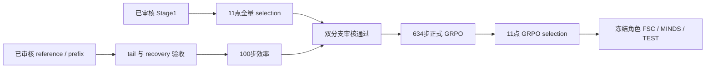

# CPU / NPU 异步实验调度

**2026-11-18 02:40 UTC更新：** v0.0.49控制器已替换v0.0.45，Stage1评测接入已验证的
并行来源审核与共同batch证明复用。新入口 `tools.reports.context_audit_optimized_pipeline`；
模板 `configs/portable/operations/context-audit-optimized-pipeline.json`，本地宏
`.local/config/context-audit-optimized-pipeline-v0.0.49.json`。见[审核链优化证据](scripted-parallel-audit-v1.md)。
以下v0.0.45启动命令及PID是历史说明，不要重复启动；当前运行根为
`/srv/multimodal-jev-xingchao/operations/context-async-pipeline-v0.0.49`。

2026-11-18 用户要求：CPU准备、收集和审核与NPU任务异步并行；已就绪的NPU评测优先执行。
这是调度变更，沿用四卡、冻结模型runtime、数据划分、loss/reward、数值门槛与评测协议。

## 当前发布与边界

开发态控制器 `v0.0.45`，入口 `tools.reports.context_async_pipeline`，共享模板
`configs/portable/operations/context-async-pipeline.json`，全部机器绑定集中在本地宏
`.local/config/context-async-pipeline-v0.0.45.json` 的 `ASYNC_PIPELINE_CONFIG`。
它不是新的已验收模型runtime rc，也没有产生新的效果结论。

2026-11-18 01:56 UTC现场：新driver PID2358767、start ticks354366066，argv核对通过。
控制器在持有原设备租约并确认175卡4–7无进程后，已退出原六个控制器
2330248、2324817、2322614、2321924、2321008、2320886；没有向远程模型进程发信号。
旧封包/配置/终态不改写，已完成Stage1、reference和prefix证据保留。
原tail尚未生成NPU attempt，替代任务使用独立位置。旧队列不应重新detach。

切换证据：
`/srv/multimodal-jev-xingchao/operations/context-async-pipeline-v0.0.45/retirement-complete.json`。
新运行根同上；事件在 `events/`，驱动身份/日志在相邻 `context-async-pipeline-v0.0.45-driver/`。
这个快照只证明控制器切换和CPU分支启动，**不代表NPU评测已启动或完成**。

## 依赖和资源



- Stage1评测不再依赖Stage2效率结论，终点318和起点0先准备；发布曲线仍按0、32…288、318排序，完整保留所有点。
- 两个评测worker流水执行准备、NPU、收集、独立审核；同时另一个CPU分支处理有限验收和效率工作。
- NPU只有一个执行槽，原四卡文件锁和远端设备空闲检查继续生效。就绪队列优先级：评测0、有限验收10、效率/正式训练20；相同优先级FIFO。不抢占已经开始的任务，不等尚未准备好的高优先级任务。
- 两次原有准入验证都移到申请NPU槽之前；原始镜像、封包hash、远程只读挂载、准确docker wait/inspect检查保持。
- 容器退出并inspect落档后释放NPU槽/设备锁；CPU收集和独立审核继续。下一项无依赖NPU任务此时可运行。
- 同一训练或同一策略评测不会重复执行。目标域相同policy角色共享推理，所有目标推理完成才评分。
- 正式GRPO仍同时需要完整Stage1曲线、prefix/tail/recovery和100步效率的独立审核。reference仍固定Stage1终点318，绝不使用selection最优点或效率终点初始化。
- 任一准备、执行或审核失败后禁止新派发，不自动重试；已经执行中的任务完成收集并保留现场。结果收集失败也不重新推理。

## 启动与观测

已有driver时**不要重复启动**。仅首次部署、完成静态核验后：

```bash
OMP_NUM_THREADS=1 PYTHONPATH=.local/verification-python:src:tools/jev \
/usr/bin/python -B -m tools.reports.context_async_pipeline \
  --config configs/portable/operations/context-async-pipeline.json \
  --local .local/config/context-async-pipeline-v0.0.45.json --action validate
```

首次启动将末尾改为 `--action detach`；此动作包含原六个准确控制器的替换，不能当作重启命令。
PID复用、任一旧driver拥有子进程、卡上已有任务、设备锁占用或出现旧NPU attempt均拒绝自动切换。
先停止旧控制器的调度能力，再检查实际卡状态；检查失败则恢复旧控制器，不跳过活任务。

事件文件包含 `npu_ready`、`npu_acquired`、`npu_released` 与时间戳，可统计就绪等待、设备占用及间隙。
`npu_released` 只表示NPU阶段结束，独立审核必须看对应 `finalization/audit.json` 和终态。
原900秒普通远程观测约定不变；正式训练复用900秒观察器。队列以线程条件事件推进，不轮询模型、不逐分钟调用远程状态或唤起模型。

## 验证

85项CPU测试通过（2026-11-18）：新增异步调度5项与现有selection、有限验收、正式后继相关80项。
覆盖就绪优先级、互斥、收集期间下一项派发、失败停止、完整曲线顺序、精确进程身份。
生命周期测试使用远端替身，不能替代NPU实际运行验收。当前控制器和所有依赖hash已固定；后续改进另发版本，不修改已运行配置或脚本。
