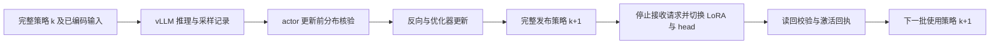

# RL 训推精度对齐：工程方法与实战案例

面向复用 verl 训练、vLLM 推理的团队。本文基于 multimodal-jev 已归档的源码和真实 Ascend 实验，整理工程实施方法；证据核对日期为 2026-11-15。重点是怎样建立一致的计算链、发现差异、修复并验收，不展开 RL 算法选型。

这里的“精度对齐”是同一输入、同一策略下计算结果的一致性。任务准确率、奖励上涨、程序正常退出，均不能代替这项验证。我们最终对齐的是输入、执行参数、前向数值、采样概率、动作 log-prob、策略切换和恢复状态这条完整链。

本文中的误差阈值和逐位相等结果只适用于已经验证的配置与样本。迁移到 CUDA、不同模型、TP、多机、量化或解码任务时，应沿用验证方法，重新建立数值基准，不能直接继承通过结论。

## 1. 先明确需要对齐的三个对象

| 对齐关系 | 实际问题 | 正确检查方式 |
| --- | --- | --- |
| HF/actor 与 vLLM | 相同权重是否得到相同的决策分布？ | 固定输入与完整策略，比较中间 hidden、logits、prob、log-prob |
| 更新前 actor 与行为策略 | 训练所用的 old log-prob 是否来自实际采样分布？ | 对记录的同一批动作检查概率、逐候选及联合动作 log-prob |
| 连续运行与恢复运行 | 保存/重载是否改变下一次更新？ | 固定下一批输入及随机状态，对比采样、master、Adam、执行参数和完整策略 |

第二项只在 actor 尚未更新、预期与行为策略同版本的时点要求一致。优化器更新后策略变化本来就是训练目标，不能要求更新后的 actor 仍等于旧行为策略。使用多轮 PPO 更新时也必须区分首次更新前检查与后续合法的策略偏移。本项目当前每批一次更新。

本项目输出 60 个独立 sigmoid 概率，harness 用固定阈值作决策；RL 探索从这些概率采样完整 60 位 Bernoulli 动作，不生成文本。因此，需要同时检查 false/true 两个分支。其他团队做 token RL 时，应把“候选位”替换成真实采样 token，并绑定温度、截断、mask 和 tokenizer 规则。

## 2. 锁定一套执行契约

先保存一个不可变的运行清单，再开始比较。仅记录模型名称和软件版本号不够。

| 类别 | 必须固定或记录的内容 |
| --- | --- |
| 软件 | 镜像内容身份、框架版本、实际源码 hash、插件与运行时补丁、导入顺序 |
| 策略 | base 权重、LoRA A/B、rank/alpha/scaling、附加 head、special token 行、processor/tokenizer |
| 输入 | 音频文件 hash、采样率与前处理版本、模板、候选定义及顺序、token IDs、mask、position IDs、音频特征与有效长度 |
| 执行 | dtype、attention/projection 实现、批大小、padding/packing、TP/DP、缓存与量化开关 |
| RL | 行为策略 ID、采样 seed、动作、old log-prob、reference 策略 ID、group 大小、有效样本权重 |
| 恢复 | 已提交更新号、数据游标、随机状态或可重建 seed、FP32 master、Adam 状态、执行参数与完整策略身份 |

机器地址通过本地宏绑定，内容身份仍需校验。共享模板用 `${NAME}`，各团队维护自己的 `.local/config/macros.json`，参考[本地宏协议](local-config-macros-v1.md)。移动路径不等于完成资产验证；改动算法、batch 或运行时 profile 后应生成新版本。

我们验证过的环境是 Ascend910B3、Qwen3-ASR-0.6B、q/v LoRA r4/alpha8、共享单层 Transformer 概率头，actor DP4、vLLM TP1。历史镜像 ID 为 `sha256:52ba94e1b6ba35f09066a92222f013ce9563fdbd83a6a5e7a60d209ac29f756c`，这是本地 Docker image ID，不是可直接拉取的 registry digest。

历史环境记录：torch 2.10.0+cpu、torch-npu 2.10.0.post7、transformers 5.14.1、peft 0.21.2、verl 0.8.0.dev0、vLLM 0.30.0+empty、vLLM-Ascend 0.30.0rc2。完整来源见[运行环境证据](npu-audio-runtime-v1-result.json)。这些版本是复现坐标，不是其他团队必须升级到的推荐版本。

## 3. 明确各阶段 dtype，检查实际执行

我们的做法是 BF16 前向执行与导出，FP32 master、Adam、梯度归约及主要 loss 运算；小规模误差诊断转到 CPU FP64。

| 环节 | 本项目约定 | 如何验证 |
| --- | --- | --- |
| backbone、LoRA、概率 head 执行 | BF16 | forward pre-hook 检查输入和参数，而非只看配置字符串 |
| FSDP | param_dtype=BF16，reduce_dtype=FP32，buffer_dtype=FP32 | 检查包装配置及实际执行记录 |
| master/Adam | FP32 | 检查每个 rank 的状态张量、参数映射和优化器步数 |
| logits 到概率 | logits 转 FP32 后 sigmoid | 保存实际输出并与 sampler 收到的 FP32 值比较 |
| 当前 Bernoulli log-prob | 小决策张量在 CPU FP32 计算 log/log1p | 保持 autograd，检查采样路径与训练路径一致 |
| 误差度量 | detached 小张量在 CPU FP64 比较 | 避免比较计算本身继续引入 BF16/FP32 舍入 |

`model.eval()` 与是否求梯度是两件事。我们关闭 dropout 等随机行为，同时保留 actor 的梯度图；不能将训练 forward 包进 `no_grad`。LoRA、head 和所有辅助模块都要检查，不能仅把 backbone 切到 eval。

不能只保存 BF16 参数然后宣称可精确恢复 FP32 优化器训练。推理发布包和训练恢复包应分别定义：前者用于重建执行策略，后者还必须包含 master、Adam 及进度状态。

实现参考：[训练器](../../tools/jev/train_context_online_candidate.py)、[行为概率检查](../../src/multimodal_jev/context_behavior_parity.py)。正式运行使用已封装快照；工作树旧模块与新数值版本并存时，以发布包内实际绑定的源码为准。

## 4. 按计算链定位首次分歧

建议固定最小复现输入和一个 checkpoint，先停止参数更新，然后沿以下顺序比较。每次只调整一个因素。

1. **核对输入。** 对比 token IDs、mask、position IDs、音频特征、有效长度和 marker 位置。音频前处理、截断、静音处理或 padding 不一致时，不应先调 kernel。
2. **核对权重。** 对 base、LoRA、附加 head、special token 行分别比较名称、shape、dtype、值和内容 hash。检查 adapter 是否实际激活，而非只加载到缓存。
3. **检查函数与算子。** 核对模型构造前后的函数对象、attention 后端、QKV/MLP 投影、归一化、RoPE、LoRA 累加和舍入顺序。
4. **逐层缩小范围。** 捕获音频 encoder 输出、语言层关键 hidden、marker hidden、head logits。记录首次出现差异的模块，不只观察最后的 argmax。
5. **拆开后处理。** 分别比较 logits、sigmoid 概率、二元 log-prob、采样动作对应的联合 log-prob。概率相同仍可能在后处理产生误差。
6. **扩展 batch 与长度。** 单条通过后，比较 serial/microbatch、短长音频、不同 padding 比例与候选长度；再进入分布式反向与更新。

### 导入顺序也属于运行契约

我们发现固定 verl 版本在首次导入时会替换 HF Qwen3 的 RMSNorm、MLP 和 rotary 函数。即使镜像、权重和 dtype 一致，actor 的方程实现也可能已经变化。

项目通过 `initialize_verl_preserving_qwen3()` 在模型构造前记录原函数对象，导入真实 verl，再只恢复经过识别的三个 NPU patch；遇到未知替换或已被修改的初始状态直接拒绝。实现见[运行时配置](../../src/multimodal_jev/span_runtime_profile.py)。这是一项针对已知版本的适配，不建议其他团队无条件撤销框架补丁。

### 批处理也是数值因素

合批可能改变矩阵形状、算子选择和归约顺序。我们将固定投影、融合变长 attention 和逐请求 head 组成版本化 profile，而不是靠随机尝试 batch 大小获得偶然一致。

当前 profile 是 `qwen3-asr-context-bf16-packed-row-v1`：backbone 合批，head 按每个请求的完整有效前缀计算，仅裁掉右侧 padding，保留真实位置。vLLM 侧限定 BF16、TP1/PP1、eager、无量化、无 prefix caching、无 chunked prefill。参考[profile](../../src/multimodal_jev/context_runtime_profile.py)、[逐请求 head](../../src/multimodal_jev/context_row_head.py)、[vLLM 边界检查](../../src/multimodal_jev/vllm_context_model.py)。这些限制描述现有已验收范围，后续放开需另行验证。

## 5. 用实际采样分布定义 old log-prob

对于一个完整动作 a，本项目使用：

```text
p_j = sigmoid_FP32(z_j)
logπ(a|x) = Σ_j [a_j log(p_j) + (1-a_j) log1p(-p_j)]
ratio = exp(logπ_actor(a|x) - logπ_behavior(a|x))
```

日志中的 old log-prob 必须与实际产生动作的概率对应。不能在训练端用另一套“数学等价”表达式重算后，默认数值相同。

更新前检查同时记录：最大概率绝对差、最大二元 log-prob 差、阈值翻转数，以及联合 log-ratio 的保守上界。对每个候选取 false/true 的最大绝对 log 差，再沿候选求和，便得到任意完整动作的界 E；其 ratio 位于 `[exp(-E), exp(E)]`。因此候选数增加后，逐位阈值不变也不代表联合比率误差预算不变。

当前行为检查门槛为 probability_max_abs≤2e-7、binary_logprob_max_abs≤2e-6、0.5 阈值翻转数=0。联合上界目前是诊断字段，**现有检查没有独立的联合上界拒绝阈值**。其他团队应根据动作维度预先登记自己的误差预算，而不是看到失败后放宽阈值。

接近0或1的概率需单独处理。当前 sampler 要求严格落在(0,1)，饱和直接失败，不静默 clamp。若业务要支持裁剪分布或其他表示，必须同时定义采样、log-prob、梯度和策略身份并重新验收。

## 6. 将策略更新视为一个完整发布事务

RL 的一个策略版本不只有 LoRA。本项目同时绑定 base、LoRA、head、marker、processor 和执行 profile。reference 策略固定；behavior 随每次已提交 actor 更新推进。



工程做法：先在 CPU 验证完整包及 native adapter，阻止新请求进入，再更新 head 和 LoRA；切换期间策略身份标记为不可服务状态。完成张量读回和匹配的 worker adapter 回执后，才发布新的 policy ID。任一环节失败则关闭该 worker，不能继续提供混合版本结果。

每批请求携带 request ID、输入身份、policy ID 和更新号，训练端拒绝过期策略。相同 ID 的纯字符串回传不足以证明激活成功，还要核验 worker 的实际权重和输出。

参考[head 激活事务](../../tools/jev/context_policy_activation.py)。该 helper 只负责 head/marker 事务，完整的 LoRA 激活、请求隔离和端到端概率核验由 owner/worker 链路共同完成；不能单独拿它的成功回执宣称训推对齐。

## 7. 用两条运行验证断点恢复

设置同一个起点、同一个完整数据日程和随机规则，运行：

- A：连续完成 update 1、update 2。
- B：读取 A 的 update 1 已提交 checkpoint，在全新进程/容器恢复，重放 update 2。

比较 update 2 的真实 batch、完整采样组、四 rank master/Adam、执行权重及完整策略。张量比较要求名称映射、结构、dtype、shape和值均一致；不要直接比较含路径、时间戳等元数据的整个目录。耗时、缓存命中、路径相关回执不要求相同。

本项目还核验恢复后的 behavior policy ID 确实来自 update 1 的已提交策略，防止 optimizer 正确恢复但 rollout 仍使用旧 adapter。具体实现见[恢复对比器](../../tools/jev/context_replay_audit.py)。

检查点文件采用本地持久盘提交；只有所有必要资产校验完毕，才发布 committed 标志。受影响 Ascend 主机上的共享 Ceph 只读，热写、缓存和恢复状态使用经过挂载检查的本地磁盘，保留本地 fsync。不能全局禁用 fsync 来解决宿主机存储故障。详见[存储规约](runtime-storage-policy.md)。

## 8. 案例一：概率完全一致，log-prob 却超差

**现象。** 一次正式启动在第一次 optimizer 更新前被拒绝，完成更新数为0。某 rank 的二元 log-prob 差达到4.0531158447265625e-6，高于2e-6门槛，而概率误差低于2e-7、阈值翻转为0。容器ExitCode1、非OOM。

**定位。** 保存失败现场，固定原策略及原128条输入，先做CPU重建，再在单NPU实际重放。actor 旧路径为 `logsigmoid(-z), logsigmoid(z)`；rollout 则对实际输出的FP32 sigmoid概率做CPU `log1p(-p), log(p)`。

一个具体候选为 iot_coffee，p=0.9790356755256653。CPU重建时推断的BF16 logit为3.84375；false分支的两种结果分别为−3.8649370670318604和−3.8649330139160156。早期logit是推断值，后续实际NPU重放才确认完整128条、7680个决策的prob完全一致。

**原因。** 有限精度下，先sigmoid再取log与直接logsigmoid有不同舍入。尤其 `log(1-p)` 对接近1的p敏感。此例不是模型输出分布不同，也没有镜像损坏证据。

**修复。** actor与sampler统一消费实际FP32 sigmoid结果，在CPU上计算同一对log函数。只迁移小决策张量，保留往返autograd：

```python
# 本项目已经验证的数值路径示意；不是任意模型/设备的通用处方。
p = logits.float().sigmoid().to('cpu')
if ((p <= 0) | (p >= 1)).any():
    raise ValueError('saturated sampling probability')
logs = torch.stack((torch.log1p(-p), torch.log(p)), dim=-1)
logs = logs.to(logits.device)  # 不detach，不替换梯度，不做straight-through
```

**验收。** 单NPU重放中旧路径有3个失败block，旧最大差4.0531158447265625e-6；新路径最大log差0，局部logit梯度比较最大绝对差1.7881393432617188e-7。随后单独完成DP4两次连续真实更新和全新进程恢复，才进入正式发布。没有放宽原门槛。

证据：[失败现场](context-formal-behavior-parity-failure-v1.json)、[实际NPU诊断](context-probability-arithmetic-npu-v1.json)、[新数值实现](../../tools/reports/context_probability_policy_v2.py)。单NPU诊断只验证前向与小logit梯度，不能单独证明整个backbone反向或多卡更新正确。

## 9. 案例二：批处理提升容量，但 head padding 改变输出

**现象。** 两条真实音频长度为2834/3104 tokens。原eager attention合批出现设备OOM；容器的OOMKilled标记并未替代框架设备OOM日志。引入融合变长attention和固定投影后能完成前后向，但共享head直接合批时，与serial的最大概率差为0.00024313。

**定位与修复。** 保留同一个合批backbone，仅让head逐请求消费完整有效前缀，裁去尾部padding，保持参数共享和梯度连通。这个受控对比将本次前向差异定位到head批处理路径，不应进一步夸大为已证明某个底层kernel缺陷。

| 同一探针中的执行方式 | 峰值allocated | 相对serial最大概率差 | 诊断梯度相对L2差 |
| --- | ---: | ---: | ---: |
| 两请求serial | 6.75 GiB | 0 | 0 |
| backbone与head均合批 | 11.29 GiB | 0.00024313 | 0.004209 |
| backbone合批、head逐请求裁尾padding | 11.28 GiB | 0 | 0.002663 |

**验收边界。** 前向变为0差，不代表梯度或后续训练轨迹逐位相同。该梯度来自诊断线性泛函，不是任务loss。之后扩展到固定256条学习音频，HF serial、micro8和vLLM同策略概率对比均为0差；多卡更新和恢复另行验证。

另外，新的融合profile与旧eager参考仍有约0.00946/0.00877概率差。我们保留两份参考，把这看作profile变化；不能用候选HF替换旧HF后，称完全保持旧模型计算结果。

证据：[批处理记录](archive/raw/context-rl-history/context-batch-capacity-and-parity-v1.md)、[两音频跨后端hidden对比](context-packed-hidden-gap-v1.json)、[256条对比](context-learning256-parity-v1.json)。单次探针耗时包含诊断和快照，不当作稳定吞吐加速比。

## 10. 案例三：证明更新、发布与恢复使用同一策略

**要解决的问题。** 静态HF/vLLM一致还不够：更新后可能只同步LoRA而漏掉head，也可能恢复BF16执行权重却丢失FP32 master或Adam。我们用真实DP4更新和新进程重放来检查这些路径。

**执行。** 修复后连续运行两次更新；另一容器从第一次checkpoint恢复并执行第二次。对比四rank训练状态、batch和采样组、BF16执行权重及完整联合策略。修复后连续两步的归档行为检查均记录0概率差、0二元log差、0阈值翻转。

**结果。** update 2的四rank master、Adam、采样、执行权重和完整策略全部精确一致。另有正式step512的独立导出检查：128个参数、6,878,209个元素，由四rank FP32 master重组后转BF16，与发布执行参数精确匹配。

**证据复用的边界。** 数值路径修改后，我们重新跑连续更新和新进程恢复。较早的checkpoint频率1/64对照，仅在验证保存/导出逻辑除明确的数值协议插入外逐字节不变后复用；没有把旧策略的轨迹当作新策略的轨迹。

证据：[DP4连续更新](context-arithmetic-grpo-prefix-v2.json)、[新进程重放比较](context-arithmetic-replay-comparison-v2.json)、[受影响链路验收](context-arithmetic-formal-acceptance-v2.json)、[step512导出核验](context-arithmetic-step512-master-export-v1.json)。这些证明工程一致性，不证明RL的任务收益，也不证明任意硬件拓扑都能逐位恢复。

## 11. 团队落地时采用的验收顺序

| 阶段 | 最小工作 | 允许得出的结论 |
| --- | --- | --- |
| 资产与输入检查 | 固定镜像/源码/模型/processor/hash；相同输入张量 | 对比对象明确，尚无数值结论 |
| CPU单元检查 | mask、padding、分布、梯度、错误路径和发布身份 | 逻辑检查通过，尚无NPU运行证据 |
| 同策略真实音频前向 | 单条、短长输入、serial/microbatch、HF/vLLM | 已覆盖输入和profile内的前向误差 |
| 实际分布检查 | 同一动作的old/current log-prob及联合ratio | 更新前采样与训练分布一致 |
| 多卡真实更新 | 完整采样组、有效样本数、梯度、master/Adam | 有限更新路径正确 |
| 策略切换与新进程恢复 | 连续两步与恢复第二步对比 | 已测拓扑和日程中的状态恢复正确 |
| 正式发布与持续检查 | 冻结运行包，每批检查策略身份，提交后独立审核 | 允许按锁定配置训练；任务收益另看完整评测 |

最小回归命令（仓库根目录、已安装匹配依赖；仅CPU逻辑测试）：

```bash
PYTHONDONTWRITEBYTECODE=1 PYTHONPATH=src:tools/jev:. python -m pytest -q -p no:cacheprovider \
  tests/test_context_behavior_parity.py \
  tests/test_context_probability_arithmetic.py \
  tests/test_context_row_head.py \
  tests/test_context_policy_activation.py \
  tests/test_context_replay_audit.py \
  tests/test_span_runtime_profile.py
```

真实NPU验收使用已存在的固定工具：

| 工作 | 工具 | 注意事项 |
| --- | --- | --- |
| 复现概率/log差 | tools.reports.diagnose_context_probability_arithmetic | 原输入和原策略，只读诊断，不更新参数 |
| bounded更新独立审核 | tools.reports.audit_context_arithmetic_candidate | 核对collection、transport、launch、package、initial-policy、schedule |
| 新数值路径合并验收 | tools.reports.context_arithmetic_acceptance.verify | 复算连续/恢复报告，检查允许复用的源码边界 |
| 全量训练独立审核 | tools.reports.audit_context_arithmetic_training | 检查全量日程、行为采样、策略和优化器；不替代评测 |

这些是本项目固定协议的工具，不能用改地址或空证明绕过准入。团队迁移时先建立自己的宏绑定与数据/模型资产证明，再发布自己的运行包，不直接复制本机容器ID或历史训练许可。

## 12. 常见现象与下一步检查

| 现象 | 优先检查 |
| --- | --- |
| 相同镜像，actor与HF也不同 | 导入patch、实际函数对象、eval/dropout、输入位置和算子profile |
| hidden一致，最终prob不同 | head权重/marker位置、padding、dtype、sigmoid实现 |
| prob一致，log-prob不同 | log表示路径、CPU/NPU计算位置、有限精度舍入、饱和 |
| 只有更新后不一致 | 完整策略发布、head是否同步、adapter激活slot、旧请求或缓存 |
| 单条通过，合批失败 | padding/packing、有效长度、shape触发的kernel变化与归约顺序 |
| 恢复后第一批就分歧 | batch游标、seed/随机状态、master/Adam、reference及behavior身份 |
| loss下降但训练无收益 | 转入任务评测与奖励诊断；数值对齐不能保证奖励设计有效 |

交接至少包括：执行契约、固定输入ID及hash、逐层/逐样本误差报告、失败复现案例、更新/恢复对比报告、不可变发布清单、未覆盖能力列表。下一团队应能用相同输入重算结论，而不是只能看到一个passed字段。

## 本文档交付核验

2026-11-15执行上面的CPU回归命令：35项通过，耗时3.07秒；有1条既有测试将带梯度
张量转标量的PyTorch warning，没有失败。21个相对文件链接均已核对存在；两步连续
更新归档中的128条行为检查记录已复核，概率误差、二元log误差和阈值翻转数均为0。
本次只整理工程方法、核对历史证据和运行CPU回归，未新增NPU训练或改变已有实验配置。

## 13. 补充案例：单条一致，batch32注意力出现差异（2026-11-17）

这个案例仍在修复验证中。它说明单条通过不能覆盖批量运行，也不能用相同kernel名称
推定相同数值路径。完整模型使用相同BF16策略、音频输入和候选定义，原32条单独推理
均一致，合批后31条logit/prob不同。以下定位不使用目标标签或任务分数。

1. 固定失败批次的顺序、完整请求长度和position IDs，分别保存HF单条与vLLM批量激活。
   捕获必须detach后复制到CPU；不更换forward结果，避免后续原位算子覆盖证据。
2. 比较语言层输入norm、Q/K/V投影、Q/K norm、RoPE及o_proj前后。首层RoPE和V逐值
   相等，而o_proj输入出现86个差异、最大绝对差0.001953125。此时可把检查范围收窄到
   注意力核输入至输出边界；不能跳到“LoRA加载错误”或“RoPE错误”的结论。
3. 从已校验捕获导出同一组Q/K/V，仅重放Ascend TND核。独立比较batch1/8/32、
   contiguous与模拟融合QKV切片的strided V、inner_precise=0/1/2。这里参数名不当作
   精度等级解释。结果四种模式的batch1和batch8均精确匹配原HF，batch32均有88个
   差异、最大绝对差0.001953125；变化布局和参数未消除差异。
4. 核重放的88个差异与原86个差异相差2个元素，须保留这个限制：当前仅支持批量形状
   敏感的定位，不能声称逐位复现所有底层执行细节或证明某个芯片算子缺陷。
5. 候选改动只限制单次attention kernel处理的请求数；服务仍接收完整batch32，声学
   与投影保持批处理。先做完整模型比较，再验本轮策略的TRAIN面板、actor更新和新进程
   恢复，最后测端到端效率。核级结果不能直接放行正式训练。

捕获中也出现过工具错误：HF o_proj输入[1,T,D]被记录为[1,T*D]，比较器因此退出。
保留失败容器和终态，校验原始文件与完整归档后，只恢复已知维度并重新比较；不能把
工具失败解释成模型不一致，也不能将恢复后的报告冒称原容器exit0。对应工具为
`tools.reports.replay_context_attention_capture`，不修改原张量值或误差阈值。

核级证据：`attention-kernel-v0.0.31`独立审核状态
`attention_kernel_independently_compared_not_admission`，报告SHA256
`71c30b779612ad39c3ce14d6f4182650736ba99a3c8828cde8a85810d4384cd6`。
原捕获维度恢复报告SHA256
`17c3d498cbb2095600f1c4f4f664f75770d8d1880ded7d0a266642c7a0672f4e`。
实际路径和后续完整模型验收见[四卡实验基线](context-four-device-simple-baseline-v1.md)。
核测试耗时包含传输、无warmup，仅为诊断，不用于宣布吞吐提升；当前不作已修复声明。


2026-11-17后续证据：分组attention完整模型候选v0.0.32已独立重算通过；原32条历史输入上，
两种声学路径的全部捕获激活、logits/prob均精确一致。报告SHA256
`be48f8f830ebb5df20167d2b5846a7ca3301d1a2b391b59f2ca89fadff16dbb9`。
这是已知失败案例的修复，不覆盖本轮Stage1终点TRAIN面板、训练恢复或吞吐；下一准入
必须保留相同实现并绑定真实来源策略，不能把诊断策略通过替换为正式训练准入。
